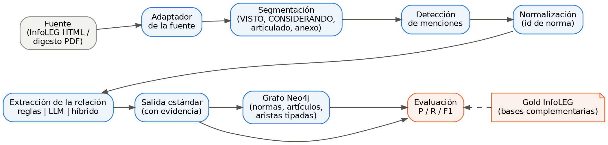

# 4. Diseño e implementación de la solución

## 4.1 Arquitectura y flujo



El sistema es una cadena de componentes independientes, como recomienda la consigna (Figura 1):

1. **Adaptador de la fuente.** Obtiene el texto del documento y lo divide en zonas y artículos, con sus offsets. Es lo **único que depende de la fuente**: `fuentes/infoleg.py` para el HTML de InfoLEG y `fuentes/unnoba.py` para los PDF del digesto.
2. **Detección de menciones.** Expresiones regulares y gazetteer.
3. **Normalización.** Pasa cada mención a un identificador del catálogo (mundo cerrado).
4. **Extracción de la relación.** Tres parsers intercambiables: reglas, LLM e híbrido.
5. **Salida estándar.** Todo parser escribe la misma tabla (`salida.py`): una fila por relación, con la fuente, la norma y el artículo de origen, la zona, el tipo, la norma y el artículo destino, el verbo, el método, la confianza y la **evidencia** (offsets y fragmento). Así, sumar un parser o una fuente no cambia ni el grafo ni la evaluación (B41, D16).
6. **Grafo.** Se arma solo desde la salida estándar (D17) y se carga en Neo4j con `MERGE`, de forma idempotente.
7. **Evaluación.** Lee el gold, y también el grafo de vuelta desde Neo4j (D18).

## 4.2 Modelo del grafo

```
(:Norma)-[:CONTIENE]->(:Articulo)
(:Articulo)-[:SUSTITUYE|INCORPORA|DEROGA|REGLAMENTA|MODIFICA|CITA]->(:Articulo | :Norma)
```

- **El origen es siempre un artículo** de la norma que contiene el texto. El VISTO y el CONSIDERANDO salen del encabezado, que es el artículo 0.
- **El destino es un artículo** cuando el texto lo dice («Sustitúyese el artículo 245…»), y la norma entera cuando no.
- **La relación es una arista tipada**, no un nodo. Una pregunta como «¿qué derogó la Ley 27.802?» se escribe directo como `[:DEROGA]`.
- **Cada arista lleva su evidencia** (fragmento y posición) y su **procedencia**: la propiedad `fuente` dice qué parser la produjo, y `metodo`, `verbo` y `confianza`, cómo.
- **Varias fuentes conviven sin pisarse.** Varios parsers sobre los mismos nodos permiten comparar dos lecturas del mismo artículo con una consulta.
- **InfoLEG no está en el grafo.** El grafo representa solo lo que extrajeron los parsers; InfoLEG se usa para medirlo (B42).

Con el parser de reglas v2, el grafo tiene 340 normas, 8.129 artículos y 3.277 relaciones tipadas: 2.332 CITA, 375 SUSTITUYE, 181 INCORPORA, 176 MODIFICA, 155 DEROGA y 58 REGLAMENTA.

La base de Neo4j del equipo tiene cargadas las cuatro fuentes de InfoLEG (reglas v2, reglas v3, LLM e híbrido) y las tres del digesto: 444 normas en total (B59, B60).

## 4.3 Métodos y tecnologías

| Componente | Tecnología |
|---|---|
| Lenguaje | Python 3.10 o superior |
| Datos y dataset | pandas, CSV (D12) |
| Modelos supervisados | scikit-learn: random forest, regresión logística, TF-IDF |
| Estadística | numpy, scipy: bootstrap pareado |
| LLM | API de Anthropic, modelo `claude-sonnet-5-5`, SDK `anthropic` |
| Grafo | Neo4j 5 en un contenedor Docker propio (puertos 7475 y 7688), driver `neo4j`; copia en memoria con networkx para los tests |
| Texto del digesto | poppler `pdftotext`, tesseract (OCR en español) |
| Figuras | matplotlib, Graphviz |
| Pruebas | pytest |
| Control de versiones | git y GitHub (`JuampiJPT/grafo-legal`) |

## 4.4 Principales decisiones

Todas las decisiones están en la bitácora (Anexo B) y en `docs/decisiones.md` (D1 a D28). Las que más condicionan los resultados son estas:

| Decisión | Por qué | Ref. |
|---|---|---|
| Evaluar «modifica o complementa» y no la modificación estricta | Es lo que mide el gold de InfoLEG. Los tipos específicos se evalúan aparte, con revisión manual | B02, B27, D6 |
| Dominio laboral con cinco anclas, expandido un salto | Profundidad del grafo, con cadenas de modificación largas, sin que una sola ley domine las métricas | B04, B18, B24 |
| Corpus congelado y un solo corpus | El portal cambia cada mes. Dos corpus confundían las comparaciones | B17, B23, B33 |
| Split temporal y test una sola vez | Simula normas nuevas y evita sobreajustar a test | B09, B16, D7 |
| El VISTO cuenta como vínculo y el CONSIDERANDO no | En dev, el 80 % de los pares del VISTO está en el gold, contra el 24 % del CONSIDERANDO | B36, D13 |
| Una salida estándar para todos los parsers | Mismo grafo y misma evaluación para cualquier parser o fuente | B41, D16 |
| Grafo con artículos como nodos y la relación como arista con evidencia | Trazabilidad y consultas directas | B38, B42, D17 |
| El LLM tiene que citar literal | Evita las relaciones inventadas: alucinación del 0,1 % | B48, D22 |
| Caché de respuestas del LLM, en git | Reproducibilidad sin clave y sin costo | B48, B53 |
| Intervalos de confianza por bootstrap | Con 192 pares, diferencias de 1 o 2 puntos pueden ser ruido | B49, D23 |
| El vocabulario de la fuente va en el adaptador | Sin él, el LLM ignora las resoluciones del digesto | B57, D28 |

## 4.5 Implementación alcanzada

| Fase | Estado | Qué hay |
|---|---|---|
| F1 · Corpus y gold | Cerrada | 340 normas, 775 pares, 306 textos, scripts que lo reproducen byte a byte |
| F2 · Segmentación, detección y normalización | Cerrada | Zonas, detector con listas y nombres propios, catálogo cerrado |
| F3 · Parser de reglas | Cerrada | v1, v2 (referencia) y v3 (experimento) |
| F4 · Parser LLM | Cerrada | Corrido sobre todo el corpus, por USD 14 |
| F5 · Híbridos | Cerrada para la cursada | Tres híbridos. El de cascada es el más eficiente |
| F6 · Grafo en Neo4j | Cerrada | Cuatro fuentes de InfoLEG y tres del digesto. Ida y vuelta idéntica. Texto consolidado de la LCT |
| F7 · Text-to-Cypher | No empezada | Cinco consultas de ejemplo con su pregunta (`docs/grafo.md`) |
| F8 · Evaluación y errores | Cerrada para la cursada | Subtareas, tipos, tabla con intervalos y explicación de cada error |
| PI4 · Digesto UNNOBA | Adelantada | 70 documentos anotados, los tres parsers y sus grafos |

El código tiene comentarios, y el recorrido para la presentación está en `docs/guia_codigo.md`. La organización del repositorio está en `docs/estructura_repositorio.md`.

# 5. Verificación de la implementación

## 5.1 Pruebas realizadas

**Pruebas automáticas** (`pytest`, sin red; `tests/test_pipeline.py` y `tests/test_unnoba.py`). Son 19 pruebas:

- Detección de menciones simples y difíciles: listas, nombres propios, año escrito como fecha.
- Catálogo: decretos, decretos-ley y conteo de ambigüedad.
- Segmentación en zonas.
- Armado del corpus sobre datos sintéticos.
- Reglas v2: procedencia y verbos.
- Tipo de relación y artículo destino.
- Ida y vuelta del grafo, sobre una copia en memoria.
- Parser LLM: verificación de la cita, normalización, prefiltro y armado de lotes, sobre respuestas simuladas.
- Modelo contextual: marcado del destino.
- Detector v3.
- Zonas y decisión del híbrido.
- Adaptador del digesto: menciones internas, listas, resoluciones del Rector, corrección del OCR, partes y claves.

**Verificaciones de reproducibilidad:**

- **Corpus.** `correr_pipeline.sh` vuelve a armar el corpus desde los zips guardados del portal y lo compara byte a byte con el congelado.
- **Textos.** Cada uno se verifica por su SHA-256.
- **Reglas v1.** Se regenera idéntica.
- **Digesto.** `26_digesto_catalogo.py --verificar` y `29_digesto_muestra.py --verificar` comprueban que el catálogo y la muestra salen iguales a los del repositorio.

**Verificación del grafo:**

- **Ida y vuelta.** Se carga cada fuente en Neo4j y se la lee de vuelta con Cypher. Lo que vuelve tiene que ser exactamente lo que se cargó.
- **Evaluación desde el grafo.** Se repite la evaluación contra InfoLEG leyendo desde Neo4j (`11_evaluar_grafo.py`, `30_cargar_y_evaluar_neo4j.sh`).

**Verificación del LLM:**

- **Anti-alucinación.** Toda cita del modelo se busca literal en el texto, y la tasa de descarte se informa.
- **Caché.** Volver a correr da exactamente lo mismo sin llamar a la API.

**Revisiones manuales** (`docs/revision_manual/`). Las hizo Claude y están pendientes de validación por el equipo:

- cobertura textual: 30 pares del gold;
- muestra de la Ley 14.250: 30 normas;
- falsos positivos de dev: 30;
- tipo de relación: 78 casos;
- detección: 60 menciones.

## 5.2 Resultados de las pruebas

| Prueba | Resultado |
|---|---|
| `pytest -q` (21/11/2026) | **19 de 19 aprobadas** |
| Corpus regenerado contra congelado (21/11/2026) | `corpus_normas.csv` y `gold_relaciones.csv` **idénticos** |
| Catálogo y muestra del digesto (`--verificar`, 21/11/2026) | Iguales a los del repositorio. Los textos del JSONL coinciden con `txt/` |
| Ida y vuelta en Neo4j | Idéntica en las cuatro fuentes: 3.277, 3.149, 3.247 y 3.147 relaciones (B60) |
| F1 de test leído desde Neo4j (reglas v2) | 0,828, igual al de los CSV |
| Citas del LLM que no están en el texto | 8 (0,1 %), descartadas |
| Cobertura textual (30 pares) | 30 de 30 categorías correctas |
| Detección (60 menciones) | 58 correctas y 2 dudosas (nombres de tributos tomados como la ley): precisión 0,97 |
| Ley 14.250 (30 normas) | Ninguna modifica el texto de la ley, lo que confirma su exclusión |

Un hallazgo de esta verificación fue que **InfoLEG tiene errores**. En 3 de los 30 falsos positivos revisados, el texto modifica la norma y el gold no lo registra (B36).

Lo que **no** se puede reproducir byte a byte está documentado en `docs/reproducibilidad.md`:

- el OCR, que cambia con la versión de tesseract;
- la descarga de los PDF del digesto, que es manual;
- una corrida nueva del LLM sin la caché.
