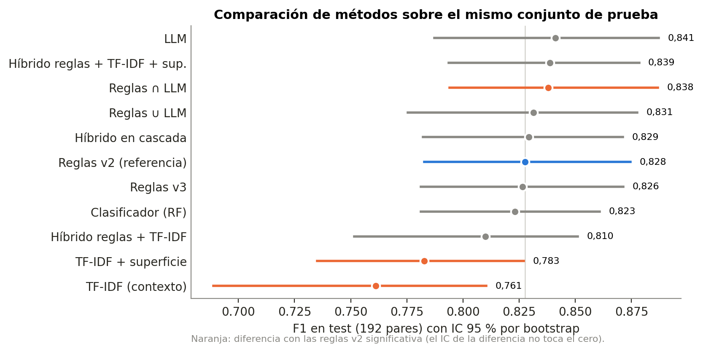
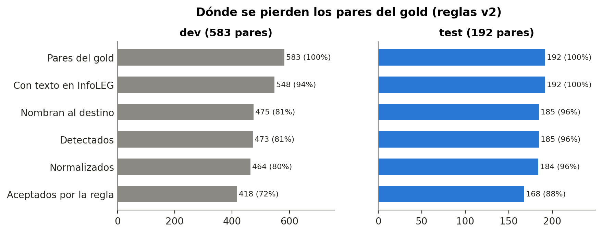
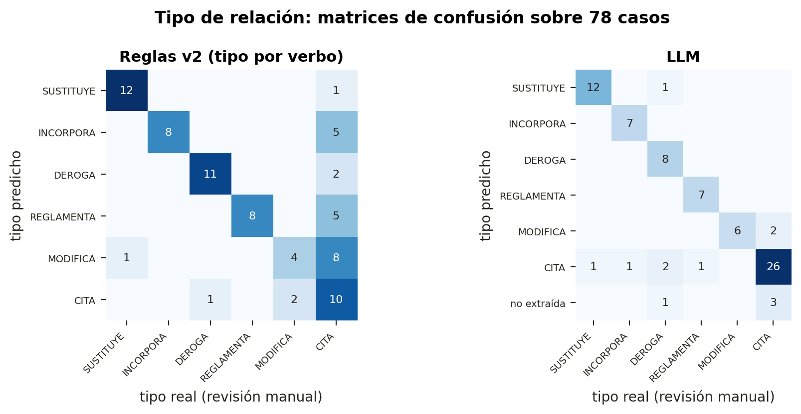
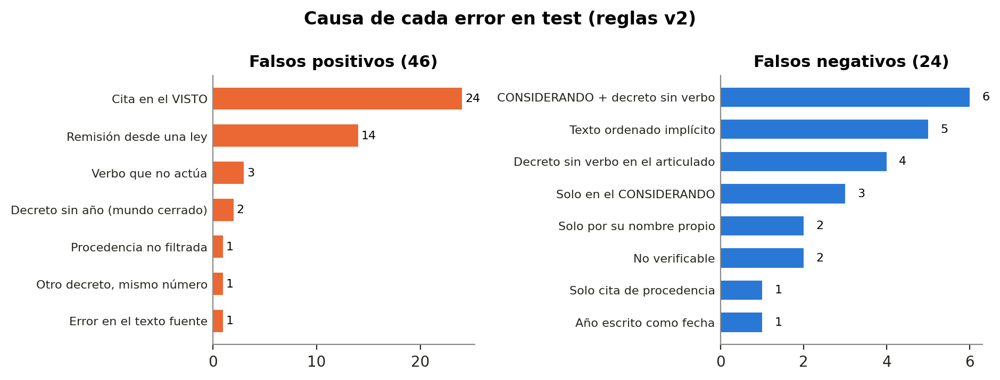
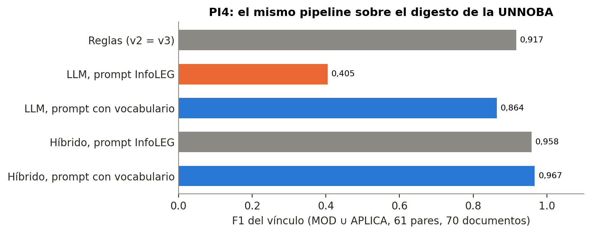
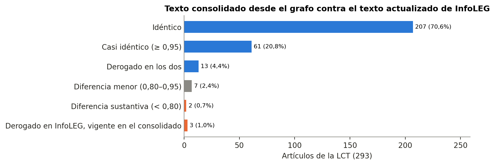
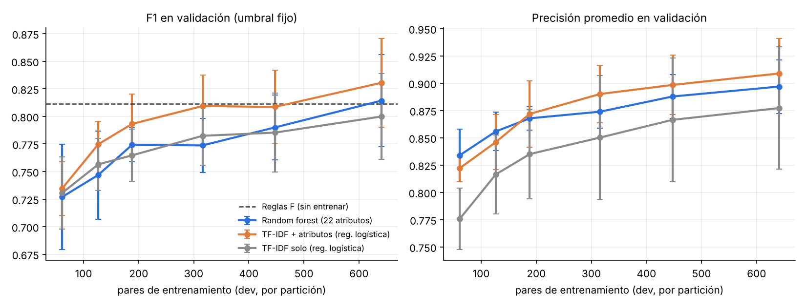

# 6. Resultados preliminares

## 6.1 Resultado principal: comparación de métodos (PI1 y PI2)

Todos los métodos se miden sobre los mismos 192 pares de test (Tabla 1 y Figura 2). Los F1 «dev» de los modelos supervisados son de validación cruzada (CV).

**Tabla 1.** Extracción de la relación «modifica o complementa». F1 en test con su intervalo de confianza del 95 % (bootstrap pareado por norma de origen, 2.000 réplicas), y diferencia con las reglas v2.

| Método | P | R | F1 dev | F1 test [IC 95 %] | Δ con reglas v2 [IC 95 %] |
|---|---|---|---|---|---|
| Reglas v1 (config. C) | 0,732 | 0,854 | 0,652 | 0,788 | — |
| **Reglas v2 (config. F, referencia)** | 0,785 | 0,875 | 0,733 | **0,828** [0,783; 0,875] | — |
| Reglas v3 (experimento) | 0,779 | 0,880 | 0,750 | 0,826 [0,781; 0,871] | −0,1 [−1,9; +1,3] |
| Clasificador (random forest) | 0,799 | 0,849 | 0,728 (CV) | 0,823 [0,781; 0,861] | −0,4 [−3,5; +2,5] |
| TF-IDF (contexto) | 0,697 | 0,839 | — | 0,761 [0,689; 0,810] | **−6,6** [−13,6; −1,5] |
| TF-IDF + superficie | 0,760 | 0,807 | 0,751 (CV) | 0,783 [0,735; 0,827] | **−4,5** [−8,6; −0,7] |
| Híbrido reglas + TF-IDF + superficie | 0,780 | 0,906 | 0,749 (CV) | 0,839 [0,794; 0,878] | +1,1 [−2,2; +4,0] |
| **Parser LLM** | 0,763 | **0,938** | 0,741 | **0,841** [0,787; 0,887] | +1,3 [−1,9; +4,0] |
| Reglas ∪ LLM | 0,747 | 0,938 | — | 0,831 [0,775; 0,878] | +0,4 [−2,7; +3,0] |
| **Reglas ∩ LLM** | **0,804** | 0,875 | 0,735 | 0,838 [0,794; 0,887] | **+1,0 [+0,2; +2,5]** |
| Híbrido en cascada | 0,761 | 0,911 | **0,758** | 0,829 [0,782; 0,871] | +0,2 [−3,4; +3,2] |

**Lectura.**

- Los tres enfoques quedan entre 0,76 y 0,84 de F1 en test. Las reglas bien diseñadas ya son competitivas (0,828).
- **Las diferencias significativas son pocas:**
  - los modelos TF-IDF solos son peores que las reglas;
  - el híbrido por intersección es mejor (+1,0 punto, intervalo de +0,2 a +2,5): sube la precisión de 0,785 a 0,804 sin perder recall.
- **El LLM es el de mayor recall (0,938).** Recupera 12 de los 24 pares que pierden las reglas: decretos sin verbo en la oración, menciones en el CONSIDERANDO y nombres propios. Pero agrega falsos positivos del VISTO, y su ventaja en F1 no es significativa (B54).
- **El híbrido en cascada es el mejor en dev (0,758)** y empata en test. Cuesta un cuarto del LLM puro, porque el modelo solo lee la zona gris (B55).
- **Las reglas generalizan peor a pares nunca vistos.** Sobre los 65 pares de test que no estaban en el corpus anterior, la v1 da 0,563 y la v2 0,671 (B35, B36).

## 6.2 Subtareas: dónde se pierden los pares

**Detección.** Se detecta el destino del 99,6 % de los pares de dev que lo nombran, y del 100 % en test.

**Normalización.** El 48 % de las menciones nombra normas reales fuera del corpus, y por mundo cerrado no se vinculan. Entre las vinculadas, la exactitud estimada es del 99,1 % en el total y del 99,4 % en test. El error principal era el año escrito como fecha («Decreto 467 del 14 de abril de 1988»):

- dejaba ambiguas 360 de 580 menciones;
- vinculaba mal 31;
- perdía 10 pares del gold.

La v3 lo corrige: las vinculaciones erróneas verificables pasan a 0 (B51, B52).

**Extracción.** Condicionado a que el par sea candidato, el recall de la regla es 0,908 en test y la precisión 0,785. En test se pierden 24 pares del gold:

| Causa | Pares |
|---|---|
| Los descarta la regla | 16 |
| No nombran a su destino | 7 |
| No se normaliza | 1 |

**Lectura.** Mejorar el detector o el catálogo no mueve el F1. Lo confirma la v3: corrige la normalización y empata en test (0,826 contra 0,828). El cuello de botella es **decidir si una cita es un vínculo**.

## 6.3 Tipo de relación

Se revisaron a mano 78 casos, 13 por tipo, estratificados (Figura 4).

**Tabla 2.** Clasificación del tipo de relación. La macro-F1 ponderada pondera cada tipo por su frecuencia en la población.

| Método | Macro-F1 (muestra) | Exactitud (muestra) | Macro-F1 ponderada | Exactitud ponderada |
|---|---|---|---|---|
| Reglas v2 (tipo por verbo) | 0,700 | 0,679 | 0,672 | 0,754 |
| Reglas v3 | 0,729 | 0,679 | 0,703 | 0,755 |
| **LLM** | **0,881** | **0,846** | **0,883** | **0,849** |
| Híbrido en cascada | 0,712 | 0,654 | 0,763 | 0,646 |

**Lectura.**

- El error dominante de las reglas es **una cita tomada como acción**: 21 de los 25 errores (B47).
  - **Nominalizaciones:** «la derogación del artículo 2°» se toma como DEROGA.
  - **Verbos que no actúan:** «deberá proponer la reglamentación» se toma como REGLAMENTA.
  - **MODIFICA:** solo 4 de las 13 predicciones son correctas.
- El LLM lee la oración y distingue la cita de la acción. Es donde más aporta.

## 6.4 Análisis de errores

Cada falso positivo y cada falso negativo de test se explicó caso por caso, con su causa y su evidencia (`results/errores_explicados/`).

**Tabla 3.** Errores de test agrupados en las categorías de la consigna (reglas v2).

| Categoría de la consigna | Causas concretas | FP | FN |
|---|---|---|---|
| Relación inexistente | Cita en el VISTO (24), remisión desde una ley (14), verbo que no actúa (3), procedencia no filtrada (1), error en el texto fuente (1) | 43 | — |
| Referencia mal normalizada o ambigua | Otro decreto con el mismo número (1), decreto sin año resuelto por mundo cerrado (2) | 3 | — |
| Norma no detectada como vínculo | CONSIDERANDO + decreto sin verbo (6), decreto sin verbo en el articulado (4), solo en el CONSIDERANDO (3), solo por nombre propio (2), solo cita de procedencia (1) | — | 16 |
| Destino no nombrado en el texto | Texto ordenado implícito (5), no verificable (2) | — | 7 |
| Referencia mal normalizada | Año escrito como fecha (1) | — | 1 |
| Relación invertida | No se observó: la dirección sale de qué norma contiene el texto | 0 | 0 |
| Tipo incorrecto | Ver sección 6.3 | — | — |
| Destino fuera del corpus | No es error de evaluación (mundo cerrado). Afecta al 48 % de las menciones | — | — |

**Formulaciones que más errores producen (PI3):**

1. **Citas del VISTO que solo mencionan la norma.** Son el 52 % de los falsos positivos de test. El VISTO es a la vez la mejor señal de vínculo (80 % de acierto en dev) y la principal fuente de error.
2. **Remisiones desde leyes** («las contribuciones previstas en la Ley 23.660»): parecen modificaciones y no lo son.
3. **Decretos que aplican una ley sin decirlo con un verbo**, o que solo la nombran en el CONSIDERANDO. InfoLEG los registra como «complementa».
4. **Vínculos que el texto no nombra.** El texto ordenado implícito («LCT t.o. 1976» vincula al Decreto 390/76), las derogaciones genéricas y las modificatorias de la citada. Entre dev y test hay 80 pares sin mención; ningún parser textual los puede encontrar (B51).
5. **El año escrito como fecha** y los decretos sin año, en la normalización.

## 6.5 Transferencia al digesto de la UNNOBA (PI4, preliminar)

Se cambió solo el adaptador y no se ajustó ninguna regla, umbral ni código de los extractores (B57, D28).

**Tabla 4.** Vínculo MOD ∪ APLICA (61 pares) en 70 documentos.

| Método | P | R | F1 |
|---|---|---|---|
| Reglas F (v2) = F3 (v3) | 0,932 | 0,902 | 0,917 |
| LLM, prompt de InfoLEG | 0,889 | 0,262 | 0,405 |
| LLM, prompt con el vocabulario del digesto | 0,895 | 0,836 | 0,864 |
| **Híbrido, prompt de InfoLEG** | **0,983** | **0,934** | **0,958** |
| Híbrido, prompt con vocabulario | 0,967 | 0,967 | 0,967 |

**Lectura.**

- **La detección se transfiere casi perfecta:** F1 = 0,986 sobre los 109 pares.
- **El híbrido es el mejor**, pero su diferencia con las reglas no es significativa con 70 documentos: el intervalo va de −0,002 a +0,101.
- **El vocabulario es la única diferencia clara.** El prompt de InfoLEG solo habla de leyes y decretos, y el LLM ignora las resoluciones. Con tres frases nuevas, el F1 sube 46 puntos (intervalo de +30 a +62).
- **Los verbos también dependen de la fuente.** El léxico de verbos de InfoLEG no tiene «ratificar» ni «dejar sin efecto» en infinitivo, y las reglas pierden la mitad del tipo MOD (F1 = 0,625).
- **Conclusión preliminar:** la transferencia funciona si el vocabulario de la fuente es parte del adaptador.

## 6.6 Reconstrucción del texto vigente desde el grafo (PI5, preliminar)

Para medir si el grafo tiene información suficiente, se reconstruyó el texto vigente de la ley con más profundidad en el grafo: la LCT, con 105 normas modificatorias y una cadena de 16 saltos (B61).

1. **Manifiesto.** Se sacó de Neo4j: 943 relaciones de 107 normas.
2. **Operaciones.** El LLM extrae de cada artículo modificatorio la operación sobre la LCT y el texto nuevo. Si el texto no está literal en la norma, la operación se descarta.
3. **Aplicación.** Se aplican en orden cronológico.
4. **Comparación.** Se compara artículo por artículo con el texto actualizado de InfoLEG, que se usa solo para medir.

**Resultados:**

- 281 de 293 artículos (95,9 %) son idénticos, casi idénticos o están derogados en los dos.
- De los 103 artículos que cambian en alguno de los dos lados, coinciden 94 (91 %).
- Las cadenas largas se reconstruyen bien: el art. 245 pasa por cinco normas y el art. 92 bis tiene seis versiones.

**Hay 6 errores reales**, y ninguno es de la consolidación:

- **Recall del grafo:** ningún parser vinculó la Ley 24.522 con la LCT, y eso afecta 4 artículos.
- **Verificación literal:** descartó una sustitución (art. 2).
- **Derogación de una norma modificatoria:** el método no la modela (art. 147).

Costo: USD 2,4 de LLM, guardado en la caché.

## 6.7 Curva de aprendizaje de los modelos supervisados

El clasificador de superficie empata con las reglas y el modelo TF-IDF queda por debajo (Tabla 1). Para saber si eso se debe a la representación o a la cantidad de datos, se entrenaron los dos con el 10, 20, 30, 50, 70 y 100 % de las normas de origen de dev (B68, `scripts/32_curva_aprendizaje.py`):

- **Validación.** Misma validación cruzada agrupada por norma de origen, con cinco sorteos por fracción.
- **Hiperparámetros.** Fijos, los que eligieron los scripts 08 y 13.
- **Test.** No se usó.

Las F1 de esta sección se miden sobre los pares candidatos, no sobre el gold completo: por eso son más altas que las de la Tabla 1.

**Tabla 5.** F1 en validación según la cantidad de pares de entrenamiento, y F1 sobre los propios datos de entrenamiento.

| Modelo | 61 pares | 316 pares | 641 pares (todo dev) | F1 en entrenamiento |
|---|---|---|---|---|
| Random forest | 0,727 | 0,774 | 0,814 | 0,936 |
| TF-IDF + atributos | 0,735 | 0,809 | 0,831 | 0,986 |
| TF-IDF solo | 0,731 | 0,782 | 0,800 | 0,992 |
| Reglas F (sin entrenar) | 0,812 | 0,812 | 0,812 | — |

**Lectura.**

- **Las curvas no se aplanan.** Ganan unos 2 puntos de F1 cada vez que se duplican los datos, y recién con todo dev alcanzan a las reglas.
- **Alta varianza.** La brecha entre entrenamiento y validación es de 0,12 a 0,19, y los modelos de texto casi memorizan el entrenamiento. Un ejemplo: la regresión logística le da peso a «bs as», que sale de la línea de la fecha («Bs. As.»).
- **Las etiquetas no explican el empate.** El análisis de errores encontró solo 5 posibles omisiones del gold en dev (B51).
- **Conclusión.** Con 801 pares, la limitación medible de los modelos supervisados es la cantidad de datos. No está probado que la representación alcance: con más datos, las curvas podrían aplanarse antes de superar con claridad a las reglas. El corpus usa alrededor del 1,5 % de las normas modificatorias que InfoLEG permite etiquetar (sección 8.1).
