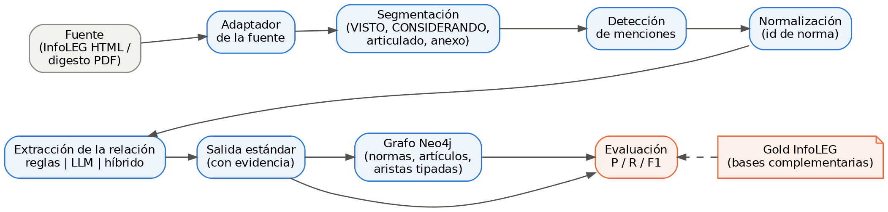
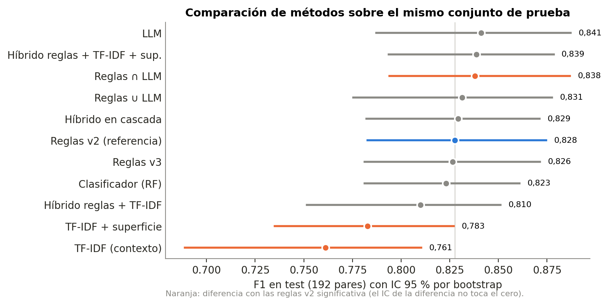
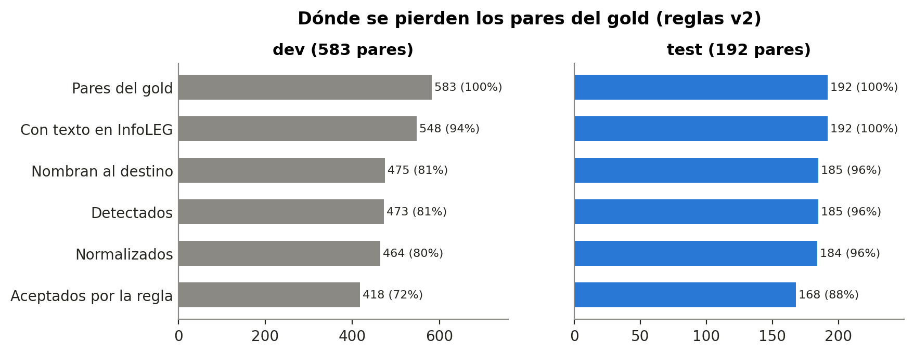
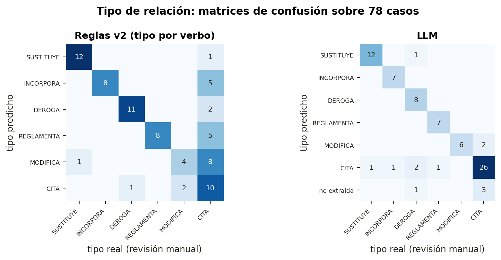
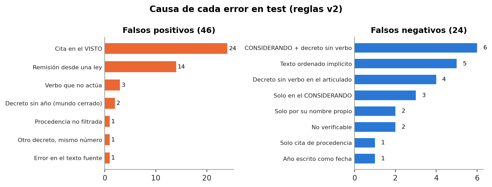
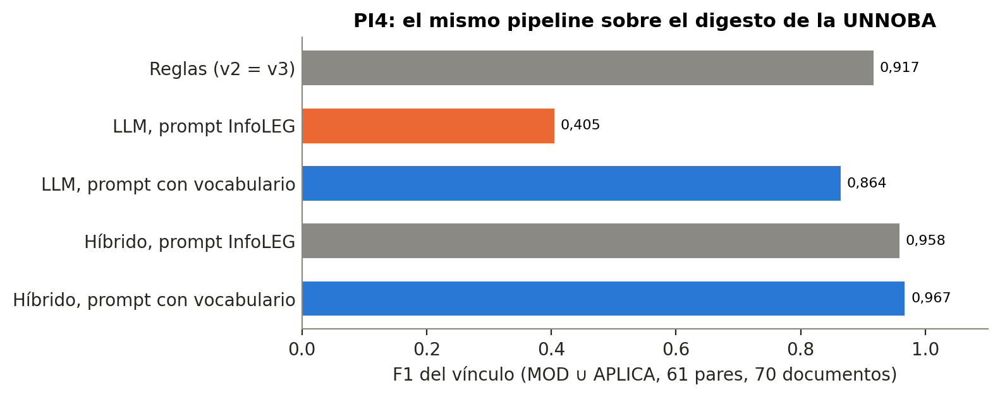
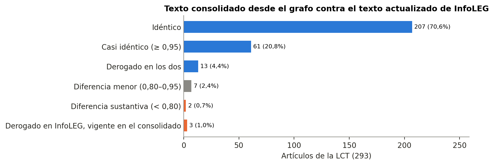
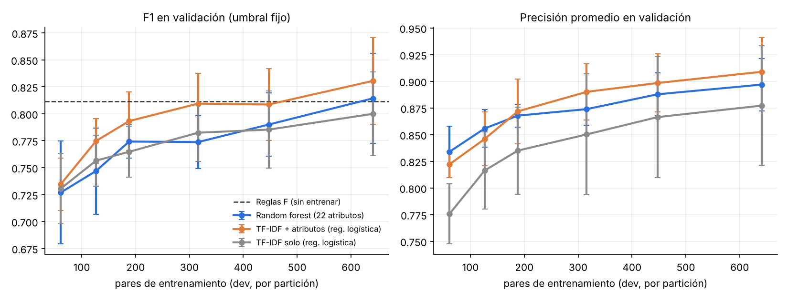

# Resumen

Este informe documenta el estado del Trabajo Práctico Integrador de la Problemática III al cierre de la cursada. El objetivo es reconstruir automáticamente, a partir del texto de las normas, las relaciones «modifica o complementa» que InfoLEG publica como datos estructurados, y representarlas en un grafo en el que cada arista conserva su evidencia textual.

Se armó un corpus reproducible del dominio laboral argentino: 340 normas, 306 con texto, y 775 pares del gold, separados en el tiempo en desarrollo (583 pares) y prueba (192 pares). Sobre él se compararon tres enfoques con el mismo protocolo:

- un parser de reglas (expresiones regulares y zonas del documento);
- modelos (un clasificador con atributos de superficie, un modelo TF-IDF y un parser con un modelo de lenguaje grande, LLM);
- estrategias híbridas.

En prueba, las reglas alcanzan F1 = 0,828, el LLM 0,841 y los híbridos entre 0,829 y 0,839. La única mejora estadísticamente significativa sobre las reglas es el híbrido por intersección: +1,0 punto, con un intervalo de confianza del 95 % de +0,2 a +2,5. El LLM mejora sobre todo el tipo de relación: macro-F1 de 0,672 a 0,883.

El análisis por subtareas muestra que la detección y la normalización casi no pierden pares. El límite está en decidir si una cita es un vínculo, en especial las citas del VISTO, y en los vínculos que el texto no nombra.

Además se adelantaron dos extensiones previstas para el examen final:

- **Transferencia (PI4).** El pipeline se aplicó a 70 documentos del digesto de la UNNOBA cambiando solo el adaptador. El híbrido alcanza F1 = 0,958.
- **Consolidación.** A partir del grafo se reconstruyó el texto vigente de la Ley de Contrato de Trabajo, que coincide con el de InfoLEG en el 95,9 % de los artículos.

**Palabras clave:** extracción de relaciones jurídicas · grafos de conocimiento normativo · InfoLEG · modelos de lenguaje · trazabilidad · Neo4j.

# 1. Introducción

## 1.1 Descripción del problema

Un cuerpo normativo es una red: las normas se modifican, sustituyen, derogan, reglamentan y citan entre sí. Para saber qué dice hoy una ley, o qué pasa si se deroga un decreto, hay que conocer esa red. En muchos repositorios los vínculos no están estructurados y solo se pueden inferir del lenguaje de las propias normas: «Sustitúyese el artículo 245 de la Ley N° 20.744 (t.o. 1976) por el siguiente…», «Derógase el Decreto N° 467/88», «VISTO la Ley N° 24.013…».

InfoLEG, la base de normativa nacional del Ministerio de Justicia, permite plantear un **experimento controlado**. Publica el texto de las normas y, por separado, bases complementarias de normas modificadas y modificatorias [1]. El sistema reconstruye las relaciones solo a partir del texto, y las bases estructuradas se usan únicamente como patrón de referencia (gold standard) para evaluar.

## 1.2 Relevancia

- **Práctica.** Un grafo de relaciones con evidencia permite responder preguntas que hoy exigen leer decenas de normas: qué artículos de la LCT cambió una ley, qué normas reglamenta un decreto, cuál es el texto vigente de un artículo.
- **Transferencia.** Muchos cuerpos normativos no tienen sus relaciones estructuradas, por ejemplo los digestos universitarios, municipales o provinciales. Un extractor validado sobre InfoLEG sería útil justamente donde no hay gold.
- **Investigación.** No conocemos un corpus en español rioplatense para extracción de relaciones entre normas evaluado contra un gold oficial. La literatura sobre grafos normativos parte de fuentes ya marcadas, como Akoma Ntoso en Italia [2, 3] o los triples anotados de EUR-Lex [4], y no del texto libre (sección 2).

## 1.3 Alcance y restricciones

- **Relación.** Se evalúa la relación general «modifica o complementa», que es la que registra InfoLEG (B02). Los tipos específicos (sustituye, incorpora, deroga, reglamenta, modifica y cita) se extraen igual y se evalúan sobre una muestra revisada a mano de 78 casos.
- **Dominio.** El derecho laboral: cinco leyes ancla (20.744 LCT, 27.802, 24.013, 24.557 y 23.551), expandidas un salto en el gráfico de relaciones de InfoLEG (B04, B08). Solo leyes, decretos y decretos-ley. Dos nodos quedan sin expandir: la Ley 14.250 y la Ley 27.742 (B07).
- **Mundo cerrado.** Una mención se vincula solo si su destino está en el corpus. Fuera del corpus se registra, pero no se enlaza (D4).
- **Fuente de verdad.** El gold nunca es entrada de un extractor (D7).
- **Restricciones operativas.**
  - El portal de datos publica una versión nueva por mes y no guarda las anteriores, así que el corpus se congeló (B17, B23).
  - El digesto de la UNNOBA prohíbe el acceso automático: los PDF se bajaron a mano (B56).
  - El LLM tiene costo (USD 14 por el corpus completo) y no es determinista, así que toda respuesta se guarda en una caché.

## 1.4 Preguntas de investigación

La pregunta principal es la **PI1**: ¿qué efectividad alcanzan distintos enfoques —reglas, modelos y estrategias híbridas— para identificar automáticamente relaciones dirigidas entre normas a partir de su texto?

Las preguntas complementarias son:

- **PI2.** ¿Una estrategia híbrida, con reglas que detectan candidatos y un modelo que resuelve la relación, mejora respecto de cada enfoque por separado?
- **PI3.** ¿Qué formulaciones normativas producen más errores en la identificación, la normalización y la clasificación?
- **PI4.** ¿Qué capacidad de transferencia tiene el extractor, con modificaciones mínimas, sobre un cuerpo normativo sin relaciones estructuradas?
- **PI5.** ¿Qué ventajas aporta un grafo que conserva la evidencia textual y la procedencia de cada vínculo?

La consigna pide abordar la PI1 durante la cursada y una primera aproximación a la PI2. Este informe responde la PI1, la PI2 y la PI3. También presenta resultados preliminares de la PI4 y la PI5, que estaban reservadas para la etapa de maduración.

# 2. Antecedentes

## 2.1 Detección y resolución de referencias normativas

La detección de referencias en textos legales es un problema clásico de extracción de información. Casi siempre se resuelve con gramáticas o expresiones regulares, porque las citas siguen patrones de técnica legislativa.

- **de Maat, Winkels y van Engers** [5] detectan estructuras de referencia en leyes neerlandesas con un parser basado en patrones.
- **Martínez-González, de la Fuente y Vicente** [6] separan tres subprocesos: detectar la cadena, resolverla a un documento o fragmento, y almacenarla. Es la misma división en detección, normalización y vinculación que pide la consigna.
- **Adedjouma, Sabetzadeh y Briand** [7] trabajan sobre la legislación de Luxemburgo y separan la detección de las referencias cruzadas de su resolución. **Sleimi et al.** [8] extienden la línea a la extracción de metadatos semánticos con reglas sobre análisis sintáctico, con precisiones de 82 % a 97 %.
- **Coupette et al.** [9] extraen las referencias de los códigos de EE.UU. y Alemania con expresiones regulares para analizar la red legislativa. Advierten que no reconocen las referencias por el nombre popular de la ley, que es uno de los problemas que encontramos (sección 6.4).

En Argentina, **Cardellino et al.** [10] trabajaron sobre InfoLEG. Detectaron entidades —sobre todo normas— con un enfoque híbrido: reglas de expresiones regulares para los casos no ambiguos y un clasificador entrenado sobre ese etiquetado o sobre una anotación manual. Su objetivo era enlazar referencias, no extraer ni evaluar relaciones entre normas.

La comparación más reciente entre paradigmas es la de **Sargeant, Östling y Magnusson** [11], sobre citas en sentencias del Reino Unido, con 190 sentencias anotadas:

| Paradigma | Macro-F1 |
|------------------------------------------------------------|----------------------------------------|
| Encoders afinados (ModernBERT) | 93,3 % |
| GPT-4.1 | 76,6 % |
| Mejor línea de base con expresiones regulares | 35,4 % |

Ese resultado muestra que el desempeño relativo de las reglas depende mucho de cuán regular sea el estilo de cita de la fuente.

## 2.2 Extracción de relaciones jurídicas y grafos normativos

- **Grafo de la legislación italiana.** **Colombo, Bernasconi y Ceri** [2] modelan la legislación como un grafo de propiedades en Neo4j. Las leyes y sus artículos son nodos, y las citas, modificaciones y derogaciones son aristas con propiedades. En un trabajo posterior [3] completan el grafo con modelos de lenguaje afinados (BERT y Mistral-7B) y reportan que capta el 98 % de las derogaciones. Las relaciones de modificación y derogación salen de la **marcación Akoma Ntoso** que publica el portal oficial (por ejemplo, las etiquetas `activeModification` y `textualMod`), no del texto libre. Los LLM se usan para asignar dominios, generar títulos y extraer temas.
- **EUR-Lex-Triples.** **Bendahman et al.** [4] publican un dataset de 1.504 documentos de la legislación europea anotados con triples. Comparan líneas de base: los modelos afinados son los mejores (Rebel-Large F1 = 0,80; Mistral-7B afinado 0,75), y el uso del LLM sin entrenar es mucho peor (0,27 a 0,47 en zero-shot o con ejemplos).
- **Grafos con LLM, desde la industria.** **Bratanič y Çelik** [12] construyen grafos de contratos con LLM y extracción guiada por esquema. De ese trabajo se tomó la salida en un esquema estructurado y la carga idempotente con `MERGE` (B03). No evalúan contra un gold ni conservan la evidencia, y extraen entidades dentro de un documento, no relaciones entre documentos.

## 2.3 Consolidación automática de textos

Aplicar las modificaciones para obtener el texto vigente es una tarea vecina, que usamos para evaluar el grafo (sección 6.6).

- **Silber** [13] automatiza el 93 % de las operaciones de consolidación del derecho francés con un lenguaje de dominio específico.
- **Etcheverry, Real y Chavallard** [14] usan un modelo generativo afinado y logran más del 63 % de éxito en un proyecto de ley difícil.
- **Prior et al.** [15] advierten que con LLM la similitud textual es alta (93 % a 99 %), pero la coincidencia exacta cae al 50,3 % en un paso y al 20,5 % en cadenas de varias modificaciones. Por eso concluyen que la salida tiene que tratarse como borrador sujeto a verificación humana.

## 2.4 Métodos, datos y métricas de la literatura

| Trabajo | Datos | Método | Métrica |
|--------------------|--------------------------------|------------------------|------------------------|
| de Maat et al. [5] | Leyes neerlandesas | Patrones | Precisión y recall de detección |
| Sleimi et al. [8] | Legislación de Luxemburgo (metadatos semánticos) | Reglas + análisis sintáctico | P = 82–97 %, R = 92–95 % |
| Cardellino et al. [10] | InfoLEG (11 documentos anotados) | Regex + clasificador NER | P, cobertura, F |
| Sargeant et al. [11] | 190 sentencias del Reino Unido | Regex / encoders / GPT-4.1 | Macro-F1 |
| Colombo et al. [2, 3] | Normattiva (Akoma Ntoso) | Mapeo de la marcación + LLM afinados para completar | Exactitud, consistencia y completitud del grafo |
| Bendahman et al. [4] | EUR-Lex (1.504 documentos) | REBEL, BERT y LLM | P, R, F1 de triples |
| Prior et al. [15] | 908 pares modificación–ley (Alemania) | LLM | Similitud y coincidencia exacta |

## 2.5 Limitaciones identificadas y oportunidad

1. **Fuentes ya marcadas.** Los grafos normativos más completos [2, 3] parten de fuentes que ya marcan la modificación. Donde no hay esa marcación, como en InfoLEG (en su texto) o en un digesto universitario, el problema es extraer las relaciones del texto libre.
2. **Falta de gold.** Los trabajos de detección de referencias evalúan con anotaciones propias, chicas. Las bases complementarias de InfoLEG permiten evaluar contra un **gold oficial, grande y externo**, aunque mide un vínculo más amplio que la modificación (sección 3.1).
3. **Comparaciones parciales entre paradigmas.** Los trabajos comparan reglas y modelos en la detección de citas [11] o en la extracción de triples [4], pero no en la **decisión de si una cita es una relación** entre normas, ni evaluando cada subtarea por separado.
4. **Trazabilidad.** Pocos trabajos conservan, en cada arista, el fragmento y el método que la produjeron. Sin eso, no se puede auditar el grafo ni usarlo como fuente de respuestas justificadas.
5. **Español rioplatense.** No encontramos un corpus para esta tarea en el español normativo argentino.

La **oportunidad** del trabajo combina:

- un corpus argentino con gold oficial;
- un protocolo reproducible que separa detección, normalización y extracción;
- tres enfoques comparados con el mismo protocolo;
- un grafo trazable;
- una primera evaluación de transferencia a un digesto sin relaciones estructuradas.

# 3. Datos y diseño experimental

## 3.1 Fuente y características de los datos

**Fuente.** La Base InfoLEG de Normativa Nacional y sus dos bases complementarias, de normas modificadas y de normas modificatorias. Las publica el Portal de Datos Abiertos de la Justicia Argentina con licencia CC BY 4.0 [1]. Se descargaron el 06/11/2026:

| Base | Filas |
|-------------------------------------------------------------------|---------------------------------|
| Normativa nacional | 430.834 |
| Normas modificatorias | 380.481 |
| Normas modificadas | 385.118 |

Los SHA-256 de los tres CSV están en `data/corpus/SNAPSHOT.md`. Los textos de las normas se bajaron del sitio de InfoLEG (306 HTML) y se guardaron con su URL, fecha y SHA-256 (`data/textos/infoleg/`).

**Corpus.** Es único y está congelado (B33, D11), dentro del dominio laboral:

- **Anclas.** Cinco leyes que se expanden un salto: 20.744 (LCT), 27.802 (modernización laboral), 24.013 (empleo), 24.557 (riesgos del trabajo) y 23.551 (asociaciones sindicales). Dos nodos no se expanden: la Ley 14.250 (convenciones colectivas), porque arrastraría cientos de normas de otro dominio (B07, B30), y la Ley 27.742.
- **Tipos de norma.** Ley, decreto y decreto-ley.
- **Tamaño.** 340 normas, 306 con texto en InfoLEG. Las 34 sin texto no tienen enlace al texto en InfoLEG; todas menos una son de 1997 o anteriores.
- **Gold.** 775 pares dirigidos (norma origen, norma destino) de las bases complementarias, restringidos a normas del corpus.

**Qué mide el gold.** InfoLEG registra un vínculo amplio. En una muestra de 21 pares con mención explícita en el texto (B27):

| Clase de vínculo | Pares |
|----------------------------------------------------------------------------|------------------------|
| Modificaciones | 7 |
| Remisiones | 9 |
| Reglamentaciones | 4 |
| Texto ordenado | 1 |

Por eso se evalúa la relación general «modifica o complementa» (D6).

**Partición temporal.** El corte es el 31/12/2019, según la fecha de la norma modificatoria (B09):

| Conjunto | Pares | Modificatorias |
|----------------------------------|-----------------|------------------------------------------------|
| Desarrollo (dev) | 583 | hasta 2019 |
| Prueba (test) | 192 | desde 2020 (43 normas de origen) |

La partición simula aplicar el sistema a normas nuevas, y la recomienda la consigna. El corpus anterior (v1, 183 normas y 402 pares) está contenido en el actual con el mismo split. `pares_evaluados_en_v1.csv` marca los pares que ya se habían mirado, para informar también el desempeño sobre pares nunca vistos.

**Techo textual.** No todo el gold se puede encontrar leyendo el texto de la modificatoria. El destino aparece nombrado en el 81 % de los pares de dev y en el 96 % de los de test. El resto son normas sin texto, vínculos que el texto no nombra (complementa sin citar, texto ordenado implícito, derogación genérica) o errores del gold (B26, B51).

**Dataset derivado.** Con pandas se armaron dos tablas (B34, D12, `docs/dataset.md`):

- `articulos.csv`: 8.066 segmentos;
- `pares_candidatos.csv`: 1.091 pares candidatos, con sus atributos y su etiqueta.

**Corpus de transferencia (PI4).** El digesto de la UNNOBA tiene 912 documentos distintos en PDF. Se bajaron a mano porque el robots.txt prohíbe el acceso automático (B56). Se sorteó una muestra estratificada de 70 con una semilla fija:

- 7 ordenanzas;
- 48 documentos de temas de reglamentos;
- 15 al azar.

Claude la anotó en tres clases (MOD, APLICA y CITA), en dos revisiones (B57, B58). Son 109 pares, de los que 61 forman el vínculo MOD ∪ APLICA.

## 3.2 Preprocesamiento

El adaptador de la fuente (`fuentes/infoleg.py`) pasa el HTML a texto limpio: saca etiquetas, notas al pie y espacios repetidos. Después lo segmenta en **zonas**:

- **encabezado**, con el VISTO y el CONSIDERANDO;
- **articulado**, partido en artículos;
- **anexos**;
- **notas de InfoLEG**.

Cada segmento conserva sus offsets en el texto limpio, que es lo que después permite que cada arista apunte a su evidencia exacta.

Para el digesto, el adaptador `fuentes/unnoba.py` hace lo mismo sobre el texto que sale de `pdftotext`, y aplica OCR (tesseract) a los 38 documentos escaneados de la muestra. Une las líneas de maquetación y reconoce las fórmulas propias del digesto: «RESUELVE:», «ORDENA:», «Regístrese…».

## 3.3 Método de referencia: reglas

El parser de reglas tiene tres etapas, que se evalúan por separado:

1. **Detección** (`extractores/menciones.py`). Dos detectores:
   - Expresiones regulares para las menciones por número: «Ley N° 24.557», «Decreto 1694/06», «leyes 23.551 y 25.674», «DNU 70/2023».
   - Un gazetteer de nombres propios: «Ley de Contrato de Trabajo», «L.C.T.», «Ley de Ministerios».
2. **Normalización** (`catalogo.py`). Cada mención (tipo, número, año) se busca en el catálogo de las 430.834 normas, y queda en uno de cuatro estados:
   - **resuelta**, si hay una sola norma posible;
   - **ambigua**, si falta el año y hay varias. Se resuelve por mundo cerrado solo si una única candidata está en el corpus;
   - **fuera del corpus**;
   - **no encontrada**.
3. **Decisión de la relación.** Una regla sobre la zona, el verbo y el tipo de norma de origen decide si la mención es un vínculo. El tipo de relación sale del verbo de la oración (`relaciones.py`).

Hay tres versiones de la regla:

- **v1** (configuración C): solo menciones del articulado, no posteriores al origen.
- **v2** (configuración F): es la **referencia del trabajo**. Acepta el par si hay una mención no posterior al origen y que no sea una cita de procedencia («t.o. por Decreto 390/76»), siempre que esté en el VISTO, o en el articulado cuando el origen es una ley o la oración tiene un verbo modificatorio (D13).
- **v3** (experimento, D25): corrige la normalización, porque lee el año escrito como fecha («Decreto 467 del 14 de abril de 1988»).

## 3.4 Soluciones evaluadas

| Enfoque | Descripción | Bitácora |
|---------------|----------------------------------------------------------------------------|----------|
| Clasificador de superficie | Random forest sobre 22 atributos de cada par candidato: menciones por zona, verbo en el artículo o en la oración, tipos de norma, diferencia de años, mención solo por nombre propio, entre otros. Validación cruzada agrupada por norma de origen en dev | B37, D14 |
| Modelo contextual | TF-IDF de la ventana de texto de cada mención, solo y con los atributos de superficie | B46, D20 |
| Parser LLM | `claude-sonnet-5-5` lee los artículos que nombran normas y devuelve, en JSON, la cita textual, la norma destino, el artículo destino, el tipo y el verbo. Si la cita no está literal en el texto, la relación se descarta (anti-alucinación). Las respuestas se guardan en una caché por huella del pedido | B48, D22 |
| Híbrido reglas + modelo contextual | El modelo decide solo donde las reglas dudan | B46 |
| Híbridos reglas ∩ LLM y reglas ∪ LLM | Combinan las dos salidas: intersección o unión | B54, D26 |
| Híbrido en cascada | Las reglas generan candidatos y los dividen en tres zonas (descarte, seguro y gris). El LLM juzga solo los seguros (para el tipo) y los grises (para la decisión), con umbrales de 0,15 y 0,5 sobre la opinión previa de la regla | B55, D27 |

## 3.5 Métricas

- **Extracción.** Precisión, recall y F1 a nivel de par dirigido (origen, destino), contra el gold de InfoLEG.
- **Detección.** Proporción de pares del gold cuyo destino se detecta en el texto.
- **Normalización.** Exactitud de vinculación (verificable contra la fecha del texto, y estimada) y proporción de menciones no resueltas, separando las que están fuera del corpus.
- **Tipo de relación.** Matriz de confusión, F1 por tipo y macro-F1 sobre 78 casos revisados a mano, 13 por tipo. Como la muestra está estratificada, se informa también la macro-F1 ponderada por la frecuencia de cada tipo en la población (D21).
- **Incertidumbre.** Intervalos de confianza del 95 % por bootstrap pareado, remuestreando las normas de origen de test (43 normas, 2.000 réplicas, semilla fija) [16]. Una diferencia es significativa si su intervalo no contiene el cero (D23).
- **Grafo.** Ida y vuelta (lo que se lee de Neo4j tiene que ser igual a lo que se cargó) y F1 contra InfoLEG leyendo desde el grafo (D18).
- **Consolidado.** Similitud por artículo (difflib sobre texto normalizado) con el texto actualizado de InfoLEG.

## 3.6 Procedimiento de evaluación

1. **El gold nunca es entrada de un extractor.** Solo lo leen los scripts de evaluación y, para entrenar, los modelos supervisados sobre dev. El parser LLM y el grafo no lo leen.
2. **Todo se diseña sobre dev.** Reglas, prompts, umbrales y proyecciones se ajustan sobre dev. Cada versión congelada se evalúa en test **una sola vez** (B16, D7). La v3 y el híbrido en cascada, que se diseñaron después de ver los errores de test de la v2, se informan como experimentos.
3. **Todos los métodos se miden sobre los mismos 192 pares de test**, con la misma proyección a pares y la misma restricción temporal (`17_comparar_metodos.py`).
4. **Cada error se explica caso por caso.** Cada falso positivo y falso negativo de test se clasifica con una causa y su evidencia (`18_explicar_errores.py`, D24), con las categorías de error de la consigna.
5. **Reproducibilidad.** Todo está en scripts numerados (`correr_pipeline.sh`). Las respuestas del LLM se guardan en caché, y el corpus se verifica byte a byte (sección 5).

# 4. Diseño e implementación de la solución

## 4.1 Arquitectura y flujo

{width=100%}

*Figura 1. Pipeline del sistema. Solo el adaptador depende de la fuente. El gold entra únicamente en la evaluación.*

El sistema es una cadena de componentes independientes, como recomienda la consigna (Figura 1):

1. **Adaptador de la fuente.** Obtiene el texto del documento y lo divide en zonas y artículos, con sus offsets. Es lo **único que depende de la fuente**: `fuentes/infoleg.py` para el HTML de InfoLEG y `fuentes/unnoba.py` para los PDF del digesto.
2. **Detección de menciones.** Expresiones regulares y gazetteer.
3. **Normalización.** Pasa cada mención a un identificador del catálogo (mundo cerrado).
4. **Extracción de la relación.** Tres parsers intercambiables: reglas, LLM e híbrido.
5. **Salida estándar.** Todo parser escribe la misma tabla (`salida.py`): una fila por relación, con la fuente, la norma y el artículo de origen, la zona, el tipo, la norma y el artículo destino, el verbo, el método, la confianza y la **evidencia** (offsets y fragmento). Así, sumar un parser o una fuente no cambia ni el grafo ni la evaluación (B41, D16).
6. **Grafo.** Se arma solo desde la salida estándar (D17) y se carga en Neo4j con `MERGE`, de forma idempotente.
7. **Evaluación.** Lee el gold, y también el grafo de vuelta desde Neo4j (D18).

## 4.2 Modelo del grafo

```
(:Norma)-[:CONTIENE]->(:Articulo)
(:Articulo)-[:SUSTITUYE|INCORPORA|DEROGA|REGLAMENTA|MODIFICA|CITA]->(:Articulo | :Norma)
```

- **El origen es siempre un artículo** de la norma que contiene el texto. El VISTO y el CONSIDERANDO salen del encabezado, que es el artículo 0.
- **El destino es un artículo** cuando el texto lo dice («Sustitúyese el artículo 245…»), y la norma entera cuando no.
- **La relación es una arista tipada**, no un nodo. Una pregunta como «¿qué derogó la Ley 27.802?» se escribe directo como `[:DEROGA]`.
- **Cada arista lleva su evidencia** (fragmento y posición) y su **procedencia**: la propiedad `fuente` dice qué parser la produjo, y `metodo`, `verbo` y `confianza`, cómo.
- **Varias fuentes conviven sin pisarse.** Varios parsers sobre los mismos nodos permiten comparar dos lecturas del mismo artículo con una consulta.
- **InfoLEG no está en el grafo.** El grafo representa solo lo que extrajeron los parsers; InfoLEG se usa para medirlo (B42).

Con el parser de reglas v2, el grafo tiene 340 normas, 8.129 artículos y 3.277 relaciones tipadas: 2.332 CITA, 375 SUSTITUYE, 181 INCORPORA, 176 MODIFICA, 155 DEROGA y 58 REGLAMENTA.

La base de Neo4j del equipo tiene cargadas las cuatro fuentes de InfoLEG (reglas v2, reglas v3, LLM e híbrido) y las tres del digesto: 444 normas en total (B59, B60).

## 4.3 Métodos y tecnologías

| Componente | Tecnología |
|--------------------------------|--------------------------------------------------------------------|
| Lenguaje | Python 3.10 o superior |
| Datos y dataset | pandas, CSV (D12) |
| Modelos supervisados | scikit-learn: random forest, regresión logística, TF-IDF |
| Estadística | numpy, scipy: bootstrap pareado |
| LLM | API de Anthropic, modelo `claude-sonnet-5-5`, SDK `anthropic` |
| Grafo | Neo4j 5 en un contenedor Docker propio (puertos 7475 y 7688), driver `neo4j`; copia en memoria con networkx para los tests |
| Texto del digesto | poppler `pdftotext`, tesseract (OCR en español) |
| Figuras | matplotlib, Graphviz |
| Pruebas | pytest |
| Control de versiones | git y GitHub (`JuampiJPT/grafo-legal`) |

## 4.4 Principales decisiones

Todas las decisiones están en la bitácora (Anexo B) y en `docs/decisiones.md` (D1 a D28). Las que más condicionan los resultados son estas:

| Decisión | Por qué | Ref. |
|--------------------------------------|-----------------------------------------------------|---------|
| Evaluar «modifica o complementa» y no la modificación estricta | Es lo que mide el gold de InfoLEG. Los tipos específicos se evalúan aparte, con revisión manual | B02, B27, D6 |
| Dominio laboral con cinco anclas, expandido un salto | Profundidad del grafo, con cadenas de modificación largas, sin que una sola ley domine las métricas | B04, B18, B24 |
| Corpus congelado y un solo corpus | El portal cambia cada mes. Dos corpus confundían las comparaciones | B17, B23, B33 |
| Split temporal y test una sola vez | Simula normas nuevas y evita sobreajustar a test | B09, B16, D7 |
| El VISTO cuenta como vínculo y el CONSIDERANDO no | En dev, el 80 % de los pares del VISTO está en el gold, contra el 24 % del CONSIDERANDO | B36, D13 |
| Una salida estándar para todos los parsers | Mismo grafo y misma evaluación para cualquier parser o fuente | B41, D16 |
| Grafo con artículos como nodos y la relación como arista con evidencia | Trazabilidad y consultas directas | B38, B42, D17 |
| El LLM tiene que citar literal | Evita las relaciones inventadas: alucinación del 0,1 % | B48, D22 |
| Caché de respuestas del LLM, en git | Reproducibilidad sin clave y sin costo | B48, B53 |
| Intervalos de confianza por bootstrap | Con 192 pares, diferencias de 1 o 2 puntos pueden ser ruido | B49, D23 |
| El vocabulario de la fuente va en el adaptador | Sin él, el LLM ignora las resoluciones del digesto | B57, D28 |

## 4.5 Implementación alcanzada

| Fase | Estado | Qué hay |
|-----------------------------|---------------------|---------------------------------------------------|
| F1 · Corpus y gold | Cerrada | 340 normas, 775 pares, 306 textos, scripts que lo reproducen byte a byte |
| F2 · Segmentación, detección y normalización | Cerrada | Zonas, detector con listas y nombres propios, catálogo cerrado |
| F3 · Parser de reglas | Cerrada | v1, v2 (referencia) y v3 (experimento) |
| F4 · Parser LLM | Cerrada | Corrido sobre todo el corpus, por USD 14 |
| F5 · Híbridos | Cerrada para la cursada | Tres híbridos. El de cascada es el más eficiente |
| F6 · Grafo en Neo4j | Cerrada | Cuatro fuentes de InfoLEG y tres del digesto. Ida y vuelta idéntica. Texto consolidado de la LCT |
| F7 · Text-to-Cypher | No empezada | Cinco consultas de ejemplo con su pregunta (`docs/grafo.md`) |
| F8 · Evaluación y errores | Cerrada para la cursada | Subtareas, tipos, tabla con intervalos y explicación de cada error |
| PI4 · Digesto UNNOBA | Adelantada | 70 documentos anotados, los tres parsers y sus grafos |

El código tiene comentarios, y el recorrido para la presentación está en `docs/guia_codigo.md`. La organización del repositorio está en `docs/estructura_repositorio.md`.

# 5. Verificación de la implementación

## 5.1 Pruebas realizadas

**Pruebas automáticas** (`pytest`, sin red; `tests/test_pipeline.py` y `tests/test_unnoba.py`). Son 19 pruebas:

- Detección de menciones simples y difíciles: listas, nombres propios, año escrito como fecha.
- Catálogo: decretos, decretos-ley y conteo de ambigüedad.
- Segmentación en zonas.
- Armado del corpus sobre datos sintéticos.
- Reglas v2: procedencia y verbos.
- Tipo de relación y artículo destino.
- Ida y vuelta del grafo, sobre una copia en memoria.
- Parser LLM: verificación de la cita, normalización, prefiltro y armado de lotes, sobre respuestas simuladas.
- Modelo contextual: marcado del destino.
- Detector v3.
- Zonas y decisión del híbrido.
- Adaptador del digesto: menciones internas, listas, resoluciones del Rector, corrección del OCR, partes y claves.

**Verificaciones de reproducibilidad:**

- **Corpus.** `correr_pipeline.sh` vuelve a armar el corpus desde los zips guardados del portal y lo compara byte a byte con el congelado.
- **Textos.** Cada uno se verifica por su SHA-256.
- **Reglas v1.** Se regenera idéntica.
- **Digesto.** `26_digesto_catalogo.py --verificar` y `29_digesto_muestra.py --verificar` comprueban que el catálogo y la muestra salen iguales a los del repositorio.

**Verificación del grafo:**

- **Ida y vuelta.** Se carga cada fuente en Neo4j y se la lee de vuelta con Cypher. Lo que vuelve tiene que ser exactamente lo que se cargó.
- **Evaluación desde el grafo.** Se repite la evaluación contra InfoLEG leyendo desde Neo4j (`11_evaluar_grafo.py`, `30_cargar_y_evaluar_neo4j.sh`).

**Verificación del LLM:**

- **Anti-alucinación.** Toda cita del modelo se busca literal en el texto, y la tasa de descarte se informa.
- **Caché.** Volver a correr da exactamente lo mismo sin llamar a la API.

**Revisiones manuales** (`docs/revision_manual/`). Las hizo Claude y están pendientes de validación por el equipo:

- cobertura textual: 30 pares del gold;
- muestra de la Ley 14.250: 30 normas;
- falsos positivos de dev: 30;
- tipo de relación: 78 casos;
- detección: 60 menciones.

## 5.2 Resultados de las pruebas

| Prueba | Resultado |
|------------------------------------------|----------------------------------------------------------|
| `pytest -q` (21/11/2026) | **19 de 19 aprobadas** |
| Corpus regenerado contra congelado (21/11/2026) | `corpus_normas.csv` y `gold_relaciones.csv` **idénticos** |
| Catálogo y muestra del digesto (`--verificar`, 21/11/2026) | Iguales a los del repositorio. Los textos del JSONL coinciden con `txt/` |
| Ida y vuelta en Neo4j | Idéntica en las cuatro fuentes: 3.277, 3.149, 3.247 y 3.147 relaciones (B60) |
| F1 de test leído desde Neo4j (reglas v2) | 0,828, igual al de los CSV |
| Citas del LLM que no están en el texto | 8 (0,1 %), descartadas |
| Cobertura textual (30 pares) | 30 de 30 categorías correctas |
| Detección (60 menciones) | 58 correctas y 2 dudosas (nombres de tributos tomados como la ley): precisión 0,97 |
| Ley 14.250 (30 normas) | Ninguna modifica el texto de la ley, lo que confirma su exclusión |

Un hallazgo de esta verificación fue que **InfoLEG tiene errores**. En 3 de los 30 falsos positivos revisados, el texto modifica la norma y el gold no lo registra (B36).

Lo que **no** se puede reproducir byte a byte está documentado en `docs/reproducibilidad.md`:

- el OCR, que cambia con la versión de tesseract;
- la descarga de los PDF del digesto, que es manual;
- una corrida nueva del LLM sin la caché.

# 6. Resultados preliminares

## 6.1 Resultado principal: comparación de métodos (PI1 y PI2)

Todos los métodos se miden sobre los mismos 192 pares de test (Tabla 1 y Figura 2). Los F1 «dev» de los modelos supervisados son de validación cruzada (CV).

**Tabla 1.** Extracción de la relación «modifica o complementa». F1 en test con su intervalo de confianza del 95 % (bootstrap pareado por norma de origen, 2.000 réplicas), y diferencia con las reglas v2.

| Método | P | R | F1 dev | F1 test [IC 95 %] | Δ con reglas v2 [IC 95 %] |
|------------------------------|-----------|-----------|-----------|--------------------|-----------------|
| Reglas v1 (config. C) | 0,732 | 0,854 | 0,652 | 0,788 | — |
| **Reglas v2 (config. F, referencia)** | 0,785 | 0,875 | 0,733 | **0,828** [0,783; 0,875] | — |
| Reglas v3 (experimento) | 0,779 | 0,880 | 0,750 | 0,826 [0,781; 0,871] | −0,1 [−1,9; +1,3] |
| Clasificador (random forest) | 0,799 | 0,849 | 0,728 (CV) | 0,823 [0,781; 0,861] | −0,4 [−3,5; +2,5] |
| TF-IDF (contexto) | 0,697 | 0,839 | — | 0,761 [0,689; 0,810] | **−6,6** [−13,6; −1,5] |
| TF-IDF + superficie | 0,760 | 0,807 | 0,751 (CV) | 0,783 [0,735; 0,827] | **−4,5** [−8,6; −0,7] |
| Híbrido reglas + TF-IDF + superficie | 0,780 | 0,906 | 0,749 (CV) | 0,839 [0,794; 0,878] | +1,1 [−2,2; +4,0] |
| **Parser LLM** | 0,763 | **0,938** | 0,741 | **0,841** [0,787; 0,887] | +1,3 [−1,9; +4,0] |
| Reglas ∪ LLM | 0,747 | 0,938 | — | 0,831 [0,775; 0,878] | +0,4 [−2,7; +3,0] |
| **Reglas ∩ LLM** | **0,804** | 0,875 | 0,735 | 0,838 [0,794; 0,887] | **+1,0 [+0,2; +2,5]** |
| Híbrido en cascada | 0,761 | 0,911 | **0,758** | 0,829 [0,782; 0,871] | +0,2 [−3,4; +3,2] |

{width=100%}

*Figura 2. F1 en test de cada método, con su intervalo de confianza del 95 %. En naranja, las diferencias con las reglas v2 que son significativas.*

**Lectura.**

- Los tres enfoques quedan entre 0,76 y 0,84 de F1 en test. Las reglas bien diseñadas ya son competitivas (0,828).
- **Las diferencias significativas son pocas:**
  - los modelos TF-IDF solos son peores que las reglas;
  - el híbrido por intersección es mejor (+1,0 punto, intervalo de +0,2 a +2,5): sube la precisión de 0,785 a 0,804 sin perder recall.
- **El LLM es el de mayor recall (0,938).** Recupera 12 de los 24 pares que pierden las reglas: decretos sin verbo en la oración, menciones en el CONSIDERANDO y nombres propios. Pero agrega falsos positivos del VISTO, y su ventaja en F1 no es significativa (B54).
- **El híbrido en cascada es el mejor en dev (0,758)** y empata en test. Cuesta un cuarto del LLM puro, porque el modelo solo lee la zona gris (B55).
- **Las reglas generalizan peor a pares nunca vistos.** Sobre los 65 pares de test que no estaban en el corpus anterior, la v1 da 0,563 y la v2 0,671 (B35, B36).

## 6.2 Subtareas: dónde se pierden los pares

{width=100%}

*Figura 3. Embudo de los pares del gold con las reglas v2. Casi toda la pérdida está en la decisión final, no en la detección ni en la normalización.*

**Detección.** Se detecta el destino del 99,6 % de los pares de dev que lo nombran, y del 100 % en test.

**Normalización.** El 48 % de las menciones nombra normas reales fuera del corpus, y por mundo cerrado no se vinculan. Entre las vinculadas, la exactitud estimada es del 99,1 % en el total y del 99,4 % en test. El error principal era el año escrito como fecha («Decreto 467 del 14 de abril de 1988»):

- dejaba ambiguas 360 de 580 menciones;
- vinculaba mal 31;
- perdía 10 pares del gold.

La v3 lo corrige: las vinculaciones erróneas verificables pasan a 0 (B51, B52).

**Extracción.** Condicionado a que el par sea candidato, el recall de la regla es 0,908 en test y la precisión 0,785. En test se pierden 24 pares del gold:

| Causa | Pares |
|----------------------------------------------------------------|------------------------------------|
| Los descarta la regla | 16 |
| No nombran a su destino | 7 |
| No se normaliza | 1 |

**Lectura.** Mejorar el detector o el catálogo no mueve el F1. Lo confirma la v3: corrige la normalización y empata en test (0,826 contra 0,828). El cuello de botella es **decidir si una cita es un vínculo**.

## 6.3 Tipo de relación

Se revisaron a mano 78 casos, 13 por tipo, estratificados (Figura 4).

**Tabla 2.** Clasificación del tipo de relación. La macro-F1 ponderada pondera cada tipo por su frecuencia en la población.

| Método | Macro-F1 (muestra) | Exactitud (muestra) | Macro-F1 ponderada | Exactitud ponderada |
|----------------|---------------------|---------------------|---------------------|---------------------|
| Reglas v2 (tipo por verbo) | 0,700 | 0,679 | 0,672 | 0,754 |
| Reglas v3 | 0,729 | 0,679 | 0,703 | 0,755 |
| **LLM** | **0,881** | **0,846** | **0,883** | **0,849** |
| Híbrido en cascada | 0,712 | 0,654 | 0,763 | 0,646 |

{width=100%}

*Figura 4. Matrices de confusión del tipo de relación sobre 78 casos. Las reglas toman muchas citas como acciones (columna CITA); el LLM casi no.*

**Lectura.**

- El error dominante de las reglas es **una cita tomada como acción**: 21 de los 25 errores (B47).
  - **Nominalizaciones:** «la derogación del artículo 2°» se toma como DEROGA.
  - **Verbos que no actúan:** «deberá proponer la reglamentación» se toma como REGLAMENTA.
  - **MODIFICA:** solo 4 de las 13 predicciones son correctas.
- El LLM lee la oración y distingue la cita de la acción. Es donde más aporta.

## 6.4 Análisis de errores

Cada falso positivo y cada falso negativo de test se explicó caso por caso, con su causa y su evidencia (`results/errores_explicados/`).

{width=100%}

*Figura 5. Causa de cada error de test con las reglas v2: 46 falsos positivos y 24 falsos negativos.*

**Tabla 3.** Errores de test agrupados en las categorías de la consigna (reglas v2).

| Categoría de la consigna | Causas concretas | FP | FN |
|-----------------------|----------------------------------------------------------------|------|------|
| Relación inexistente | Cita en el VISTO (24), remisión desde una ley (14), verbo que no actúa (3), procedencia no filtrada (1), error en el texto fuente (1) | 43 | — |
| Referencia mal normalizada o ambigua | Otro decreto con el mismo número (1), decreto sin año resuelto por mundo cerrado (2) | 3 | — |
| Norma no detectada como vínculo | CONSIDERANDO + decreto sin verbo (6), decreto sin verbo en el articulado (4), solo en el CONSIDERANDO (3), solo por nombre propio (2), solo cita de procedencia (1) | — | 16 |
| Destino no nombrado en el texto | Texto ordenado implícito (5), no verificable (2) | — | 7 |
| Referencia mal normalizada | Año escrito como fecha (1) | — | 1 |
| Relación invertida | No se observó: la dirección sale de qué norma contiene el texto | 0 | 0 |
| Tipo incorrecto | Ver sección 6.3 | — | — |
| Destino fuera del corpus | No es error de evaluación (mundo cerrado). Afecta al 48 % de las menciones | — | — |

**Formulaciones que más errores producen (PI3):**

1. **Citas del VISTO que solo mencionan la norma.** Son el 52 % de los falsos positivos de test. El VISTO es a la vez la mejor señal de vínculo (80 % de acierto en dev) y la principal fuente de error.
2. **Remisiones desde leyes** («las contribuciones previstas en la Ley 23.660»): parecen modificaciones y no lo son.
3. **Decretos que aplican una ley sin decirlo con un verbo**, o que solo la nombran en el CONSIDERANDO. InfoLEG los registra como «complementa».
4. **Vínculos que el texto no nombra.** El texto ordenado implícito («LCT t.o. 1976» vincula al Decreto 390/76), las derogaciones genéricas y las modificatorias de la citada. Entre dev y test hay 80 pares sin mención; ningún parser textual los puede encontrar (B51).
5. **El año escrito como fecha** y los decretos sin año, en la normalización.

## 6.5 Transferencia al digesto de la UNNOBA (PI4, preliminar)

Se cambió solo el adaptador y no se ajustó ninguna regla, umbral ni código de los extractores (B57, D28).

{width=100%}

*Figura 6. F1 del vínculo en 70 documentos del digesto de la UNNOBA.*

**Tabla 4.** Vínculo MOD ∪ APLICA (61 pares) en 70 documentos.

| Método | P | R | F1 |
|--------------------------------------------|-------------------|-------------------|-------------------|
| Reglas F (v2) = F3 (v3) | 0,932 | 0,902 | 0,917 |
| LLM, prompt de InfoLEG | 0,889 | 0,262 | 0,405 |
| LLM, prompt con el vocabulario del digesto | 0,895 | 0,836 | 0,864 |
| **Híbrido, prompt de InfoLEG** | **0,983** | **0,934** | **0,958** |
| Híbrido, prompt con vocabulario | 0,967 | 0,967 | 0,967 |

**Lectura.**

- **La detección se transfiere casi perfecta:** F1 = 0,986 sobre los 109 pares.
- **El híbrido es el mejor**, pero su diferencia con las reglas no es significativa con 70 documentos: el intervalo va de −0,002 a +0,101.
- **El vocabulario es la única diferencia clara.** El prompt de InfoLEG solo habla de leyes y decretos, y el LLM ignora las resoluciones. Con tres frases nuevas, el F1 sube 46 puntos (intervalo de +30 a +62).
- **Los verbos también dependen de la fuente.** El léxico de verbos de InfoLEG no tiene «ratificar» ni «dejar sin efecto» en infinitivo, y las reglas pierden la mitad del tipo MOD (F1 = 0,625).
- **Conclusión preliminar:** la transferencia funciona si el vocabulario de la fuente es parte del adaptador.

## 6.6 Reconstrucción del texto vigente desde el grafo (PI5, preliminar)

Para medir si el grafo tiene información suficiente, se reconstruyó el texto vigente de la ley con más profundidad en el grafo: la LCT, con 105 normas modificatorias y una cadena de 16 saltos (B61).

1. **Manifiesto.** Se sacó de Neo4j: 943 relaciones de 107 normas.
2. **Operaciones.** El LLM extrae de cada artículo modificatorio la operación sobre la LCT y el texto nuevo. Si el texto no está literal en la norma, la operación se descarta.
3. **Aplicación.** Se aplican en orden cronológico.
4. **Comparación.** Se compara artículo por artículo con el texto actualizado de InfoLEG, que se usa solo para medir.

{width=100%}

*Figura 7. Texto consolidado de la LCT armado desde el grafo, comparado artículo por artículo con el texto actualizado de InfoLEG.*

**Resultados:**

- 281 de 293 artículos (95,9 %) son idénticos, casi idénticos o están derogados en los dos.
- De los 103 artículos que cambian en alguno de los dos lados, coinciden 94 (91 %).
- Las cadenas largas se reconstruyen bien: el art. 245 pasa por cinco normas y el art. 92 bis tiene seis versiones.

**Hay 6 errores reales**, y ninguno es de la consolidación:

- **Recall del grafo:** ningún parser vinculó la Ley 24.522 con la LCT, y eso afecta 4 artículos.
- **Verificación literal:** descartó una sustitución (art. 2).
- **Derogación de una norma modificatoria:** el método no la modela (art. 147).

Costo: USD 2,4 de LLM, guardado en la caché.

## 6.7 Curva de aprendizaje de los modelos supervisados

El clasificador de superficie empata con las reglas y el modelo TF-IDF queda por debajo (Tabla 1). Para saber si eso se debe a la representación o a la cantidad de datos, se entrenaron los dos con el 10, 20, 30, 50, 70 y 100 % de las normas de origen de dev (B68, `scripts/32_curva_aprendizaje.py`):

- **Validación.** Misma validación cruzada agrupada por norma de origen, con cinco sorteos por fracción.
- **Hiperparámetros.** Fijos, los que eligieron los scripts 08 y 13.
- **Test.** No se usó.

Las F1 de esta sección se miden sobre los pares candidatos, no sobre el gold completo: por eso son más altas que las de la Tabla 1.

{width=100%}

*Figura 8. Curva de aprendizaje: F1 y precisión promedio en validación según la cantidad de pares de entrenamiento, con el desvío entre particiones. La línea punteada es la regla F, que no se entrena.*

**Tabla 5.** F1 en validación según la cantidad de pares de entrenamiento, y F1 sobre los propios datos de entrenamiento.

| Modelo | 61 pares | 316 pares | 641 pares (todo dev) | F1 en entrenamiento |
|------------------------|--------------|--------------|--------------|-----------------------------------|
| Random forest | 0,727 | 0,774 | 0,814 | 0,936 |
| TF-IDF + atributos | 0,735 | 0,809 | 0,831 | 0,986 |
| TF-IDF solo | 0,731 | 0,782 | 0,800 | 0,992 |
| Reglas F (sin entrenar) | 0,812 | 0,812 | 0,812 | — |

**Lectura.**

- **Las curvas no se aplanan.** Ganan unos 2 puntos de F1 cada vez que se duplican los datos, y recién con todo dev alcanzan a las reglas.
- **Alta varianza.** La brecha entre entrenamiento y validación es de 0,12 a 0,19, y los modelos de texto casi memorizan el entrenamiento. Un ejemplo: la regresión logística le da peso a «bs as», que sale de la línea de la fecha («Bs. As.»).
- **Las etiquetas no explican el empate.** El análisis de errores encontró solo 5 posibles omisiones del gold en dev (B51).
- **Conclusión.** Con 801 pares, la limitación medible de los modelos supervisados es la cantidad de datos. No está probado que la representación alcance: con más datos, las curvas podrían aplanarse antes de superar con claridad a las reglas. El corpus usa alrededor del 1,5 % de las normas modificatorias que InfoLEG permite etiquetar (sección 8.1).

# 7. Discusión, limitaciones y amenazas a la validez

## 7.1 Interpretación de los resultados

**PI1: efectividad de cada enfoque.** Reglas, modelos y LLM llegan a F1 de 0,76 a 0,84 en test. Las reglas a mano y un clasificador entrenado con los mismos atributos empatan (0,828 y 0,823): la curva de aprendizaje muestra que los dos modelos supervisados seguían mejorando con más datos y tienen alta varianza, así que el empate se explica sobre todo por el tamaño del dataset de entrenamiento (801 pares de dev) y no está probado que sea un techo de los atributos (B37, B68). El LLM aporta en dos lugares:

- **el recall**, porque lee la oración y el CONSIDERANDO;
- **el tipo de relación**, con macro-F1 de 0,672 a 0,883.

El parecido entre métodos tan distintos sugiere que **el techo no está en el método sino en la tarea**. Hay dos razones:

- una parte del gold no se puede encontrar leyendo el texto de la modificatoria;
- InfoLEG registra algunas citas del VISTO y otras no, sin un criterio que se lea en el texto.

**PI2: el híbrido.** El híbrido mejora, pero poco. La intersección de reglas y LLM es la única mejora significativa (+1 punto, por precisión). El híbrido en cascada logra el mismo F1 a un cuarto del costo, y en el digesto es el mejor de todos. Coincide con lo que pide la consigna: las reglas detectan candidatos de forma barata y casi sin errores, y el modelo decide donde las reglas dudan.

**PI3: formulaciones problemáticas.** El análisis caso por caso cambió dónde se puso el esfuerzo. La detección y la normalización casi no pierden pares. Los errores se concentran en:

- las citas sin acción del VISTO;
- las remisiones desde leyes;
- los decretos que aplican una ley sin verbo;
- los vínculos que el texto no nombra.

La lección metodológica es que **sin evaluar por subtarea, el siguiente paso habría sido seguir puliendo el detector**, que ya estaba en el 99,6 %.

**PI4 y PI5, preliminares.** La arquitectura con el adaptador como único punto que depende de la fuente funcionó: el digesto corrió con los mismos extractores. El grafo conserva suficiente información para reconstruir el texto vigente de una ley con 105 modificatorias. Esa es la evidencia más fuerte de que la trazabilidad, con el artículo destino y la evidencia en cada arista, aporta algo que una tabla de pares no tiene.

**Comparación con la literatura.** Nuestras reglas son mucho mejores que las del Reino Unido [11] (0,83 contra 0,35), y el LLM no queda por debajo de las reglas, como sí pasaba allí. Lo atribuimos a dos diferencias:

- **la tarea:** decidir un vínculo entre normas de un catálogo, no detectar cualquier cita en una sentencia;
- **el estilo:** la técnica legislativa argentina es muy regular.

A diferencia del grafo italiano [2, 3], las modificaciones no vienen marcadas y hay que extraerlas del texto. El costo de eso es justamente el F1 de 0,83.

## 7.2 Limitaciones de datos y método

1. **El gold mide un vínculo amplio y tiene ruido.** «Modifica o complementa» incluye remisiones y textos ordenados. En 3 de 30 falsos positivos revisados, el vínculo es real y no está en InfoLEG (B36). El F1 contra InfoLEG subestima un poco la calidad real y mezcla dos tareas distintas.
2. **Tamaño de test.** Son 192 pares de 43 normas de origen. Los intervalos de confianza tienen unos ±4,5 puntos, y diferencias de 1 o 2 puntos no se pueden afirmar.
3. **Anotaciones de una sola persona, y no humana.** Las revisiones manuales (tipos, cobertura, falsos positivos, menciones) y el gold de la PI4 los hizo Claude. No hay acuerdo entre anotadores (kappa) ni validación del equipo. Es la limitación más importante para la PI3 y la PI4.
4. **Mundo cerrado.** Solo se vincula lo que está en el corpus. El 48 % de las menciones nombra normas reales fuera de él. La regla F acierta contra la base completa de InfoLEG el 62 % de las veces en test (B45), pero eso no se evaluó como tarea principal.
5. **Un solo dominio y dos tipos de norma.** Laboral; leyes y decretos. Las resoluciones y disposiciones solo aparecen en la PI4.
6. **El LLM es un servicio externo.** El modelo puede cambiar o dejar de estar disponible. La caché fija los resultados del trabajo, pero no garantiza que una corrida futura dé lo mismo (`docs/reproducibilidad.md`).
7. **El diseño de la v3 y del híbrido en cascada** fue posterior a ver los errores de test de la v2. Por eso se informan como experimentos, y la v2 sigue siendo la referencia.
8. **La PI4 es chica.** 70 documentos y 61 pares de vínculo; 38 documentos con OCR, que no es reproducible byte a byte.
9. **El consolidado no es texto oficial.** No modela vigencias diferidas, suspensiones judiciales, vetos ni derogaciones de normas modificatorias.

## 7.3 Amenazas a la validez

- **Validez interna.**
  - **Fuga de información de test.** Se mitigó congelando cada versión antes de evaluarla y evaluando una sola vez. La amenaza que queda es que los autores conocen el dominio y vieron errores de test de la v2 antes de diseñar la v3.
  - **Sesgo de selección del corpus.** El corpus se construye a partir del propio gold (expansión de las anclas), así que solo contiene normas que InfoLEG ya vinculó (B15). Una muestra independiente del gold está en el plan de maduración.
- **Validez de constructo.** El gold de InfoLEG no es «la verdad», sino lo que el Ministerio registró. Medir contra él premia imitar su criterio editorial, por ejemplo qué citas del VISTO registra.
- **Validez externa.** Los resultados no deberían generalizarse a:
  - otros dominios, como el tributario, donde las remisiones a leyes de impuestos serían mucho más frecuentes;
  - normas de otras épocas, con estilos de cita distintos (los decretos sin año);
  - fuentes con otra estructura de documento, sin VISTO o CONSIDERANDO;
  - otros modelos de lenguaje o versiones del prompt;
  - el texto extraído de PDF con OCR de baja calidad.
- **Validez de conclusión.** Muchas comparaciones (11 métodos) sobre el mismo test aumentan la chance de encontrar una diferencia «significativa» por azar. La mejora del híbrido por intersección (+1 punto) se tiene que confirmar sobre otra muestra.

# 8. Plan de maduración

## 8.1 Experimentos pendientes

1. **Validación humana y acuerdo entre anotadores.** El equipo valida las revisiones manuales y el gold de la PI4. Un segundo anotador repite una parte de cada uno, y se calcula el kappa de Cohen (B58).
2. **Gold de tipos más grande y doble anotación.** Ampliar los 78 casos de tipos, con la guía de anotación escrita.
3. **Muestra independiente del gold** (B15). Normas del dominio que no vienen de la expansión de InfoLEG, para medir la precisión sin el sesgo de selección.
4. **Comparar modelos de lenguaje:** Sonnet, Haiku y un modelo abierto. Medir costo y desempeño, y su sensibilidad al prompt.
5. **Reglas v4,** diseñadas sobre dev: los ajustes identificados en B52 y B57, como «creado por», «inclúyense», los verbos en infinitivo y la condición del verbo antes de la mención.
6. **Ampliar la PI4.** Más documentos del digesto y otro digesto (provincial o municipal), con anotación humana.
7. **Text-to-Cypher (F7).** Un banco de preguntas en lenguaje natural con su consulta esperada, evaluado por *execution accuracy*.
8. **Análisis temporal y consultas sobre el grafo.** Cadenas de modificación, normas más modificadas y vigencia.
9. **Ampliar el corpus de entrenamiento y revisar las pruebas de los modelos supervisados** (B68). La curva de aprendizaje sigue subiendo con los 801 pares de dev. Queda abierta la posibilidad de sumar normas de InfoLEG, repetir la curva con el doble y con 10 veces más datos, y ver si los modelos superan a las reglas o si se aplanan antes.

## 8.2 Mejoras

- **El VISTO como señal graduada,** que distinga la lista de antecedentes de la norma que se reglamenta o modifica. Es el principal punto de falsos positivos.
- **El consolidado:** modelar la derogación de modificatorias y las vigencias diferidas, y aflojar la verificación literal para los cambios parciales.
- **La descarga y el OCR del digesto:** guardar los HTML de las secciones y escribir el script que reconstruye el catálogo desde ellos.
- **Embeddings en el grafo,** si suman a las consultas (B38).

## 8.3 Información adicional necesaria

Hay que consultar con la cátedra:

- si se acepta la supervisión distante;
- si se evalúa también la modificación estricta y la clasificación fina (B02, B14, B27);
- la extensión esperada del artículo final.

También hace falta tiempo del equipo para las anotaciones humanas.

## 8.4 Actividades previstas antes del examen final

| Actividad | Producto |
|---------------------------------------|-------------------------------------------------------------|
| Validación humana y segundo anotador | Kappa de Cohen para tipos, cobertura y gold de la PI4 |
| Muestra independiente y reglas v4 | Precisión sin sesgo de selección. Nueva tabla de métodos |
| Comparación de modelos de lenguaje | Costo y desempeño por modelo |
| PI4 ampliada | Transferencia con gold humano y con más documentos |
| Text-to-Cypher | Demo y evaluación sobre el grafo |
| Artículo científico (formato LNCS) | Redacción a partir de este informe y de `docs/conclusiones.md` |

# 9. Referencias bibliográficas

1. Ministerio de Justicia de la Nación Argentina. Base InfoLEG de Normativa Nacional y bases complementarias de normas modificadas y modificatorias. Portal de Datos Abiertos de la Justicia Argentina, licencia CC BY 4.0. http://datos.jus.gob.ar/dataset/base-de-datos-legislativos-infoleg (descarga del 06/11/2026).
2. Colombo, A., Bernasconi, A., Ceri, S.: Modelling Legislative Systems into Property Graphs to Enable Advanced Pattern Detection. arXiv:2406.14935 (2024). Dataset: Italian Legislative Property Graph, Zenodo, doi:10.5281/zenodo.11210265.
3. Colombo, A., Bernasconi, A., Ceri, S.: An LLM-assisted ETL pipeline to build a high-quality knowledge graph of the Italian legislation. Information Processing & Management 62, 104082 (2025). doi:10.1016/j.ipm.2025.104082.
4. Bendahman, N., Pinel-Sauvagnat, K., Hubert, G., Billami, M.B.: EUR-Lex-Triples: A Legal Relation Extraction Dataset from European Legislation. En: Linking Theory and Practice of Digital Libraries (TPDL 2025). LNCS, pp. 433–451. Springer (2025). doi:10.1007/978-3-032-05409-8_25.
5. de Maat, E., Winkels, R., van Engers, T.: Automated Detection of Reference Structures in Law. En: Legal Knowledge and Information Systems (JURIX 2006). Frontiers in Artificial Intelligence and Applications 152, pp. 41–50. IOS Press (2006).
6. Martínez-González, M., de la Fuente, P., Vicente, D.-J.: Reference Extraction and Resolution for Legal Texts. En: Pattern Recognition and Machine Intelligence (PReMI 2005). LNCS 3776. Springer (2005).
7. Adedjouma, M., Sabetzadeh, M., Briand, L.: Automated Detection and Resolution of Legal Cross References: Approach and a Study of Luxembourg's Legislation. En: IEEE 22nd International Requirements Engineering Conference (RE 2014), pp. 63–72 (2014).
8. Sleimi, A., Sannier, N., Sabetzadeh, M., Briand, L., Ceci, M., Dann, J.: An Automated Framework for the Extraction of Semantic Legal Metadata from Legal Texts. Empirical Software Engineering 26(3), 43 (2021).
9. Coupette, C., Beckedorf, J., Hartung, D., Bommarito, M., Katz, D.M.: Measuring Law Over Time: A Network Analytical Framework with an Application to Statutes and Regulations in the United States and Germany. arXiv:2101.11284 (2021).
10. Cardellino, F., Cardellino, C., Haag, K., Soto, A., Teruel, M., Alonso Alemany, L., Villata, S.: Mejora del acceso a Infoleg mediante técnicas de procesamiento automático del lenguaje. En: Simposio Argentino de Informática y Derecho (SID), 47 JAIIO (2018).
11. Sargeant, H., Östling, A., Magnusson, M.: Detecting Legal Citations in United Kingdom Court Judgments. En: Proceedings of EMNLP 2025, pp. 26810–26836. ACL (2025).
12. Bratanič, T., Çelik, T.: From Legal Documents to Knowledge Graphs. Neo4j Developer Blog (2025). https://neo4j.com/blog/developer/from-legal-documents-to-knowledge-graphs/
13. Silber, G.-A.: Towards an Automatic Consolidation of French Law. arXiv:2301.06469 (2023).
14. Etcheverry, M., Real, T., Chavallard, P.: Algorithm for Automatic Legislative Text Consolidation. En: Proceedings of the Natural Legal Language Processing Workshop (NLLP 2024), pp. 166–175. ACL (2024).
15. Prior, M., Hof, A., Wais, N., Grabmair, M.: Risks and Limits of Automatic Consolidation of Statutes. En: Proceedings of the Natural Legal Language Processing Workshop (NLLP 2025), pp. 396–407. ACL (2025).
16. Efron, B., Tibshirani, R.J.: An Introduction to the Bootstrap. Chapman & Hall/CRC (1993).

# Anexo A. Repositorio e implementación

- **Repositorio:** https://github.com/JuampiJPT/grafo-legal
- **Instalación, ejecución y configuración:** `README.md`
- **Estructura:** `docs/estructura_repositorio.md`
- **Qué se repite exacto y qué no:** `docs/reproducibilidad.md`
- **Conclusiones y cómo se llegó a cada una:** `docs/conclusiones.md`
- **Las figuras de este informe** se regeneran con `python scripts/31_figuras_informe.py`.

# Anexo B. Bitácora de investigación

La bitácora registra, con fecha, cada decisión, dificultad, hallazgo y cuestionamiento del trabajo, con su contexto, las alternativas y cómo quedó. Las entradas no se borran: si una decisión cambia, se agrega otra que la reemplaza. A continuación se transcriben las entradas de la investigación, de B01 a B64 y B68. Cuando un punto que había quedado abierto se resolvió después, la entrada lo indica con una nota de *Seguimiento*. Lo que sigue pendiente está resumido en el plan de maduración (sección 8). En esta transcripción se omiten tres cosas: el estado de cada entrada, la lista interna de tareas y las entradas sobre el video explicativo y la revisión final de este informe. La versión completa es «00 - Bitácora del TP», en la carpeta del Drive, y la copia está en `docs/drive/00_bitacora.md`.


## Bitácora del TP Integrador

*Sistemas Inteligentes (UNNOBA). Problemática III: extracción de relaciones entre normas y grafo normativo trazable. Iniciada el 27/10/2026, última entrada el 25/11/2026.*

### Cómo usar esta bitácora

Cada entrada registra una decisión, una dificultad, un hallazgo o un cuestionamiento, con su contexto, las alternativas consideradas y cómo quedó. Las entradas no se borran: si una decisión cambia, se agrega una entrada nueva que la reemplaza y se cita la anterior. Así el informe final puede reconstruir por qué el sistema quedó como quedó, y las secciones de Metodología, Limitaciones y Amenazas a la validez salen de acá.

Tipos de entrada: **Decisión** (se eligió un camino), **Dificultad** (algo trabó el trabajo), **Hallazgo** (algo que aprendimos de los datos) y **Cuestionamiento** (una pregunta metodológica que alguien puede hacernos en la defensa).

### Índice de entradas

- **B01** · 27/10 · Decisión · El grafo y el text-to-Cypher se subordinan al núcleo evaluable
- **B02** · 27/10 · Decisión · Relación general "modifica o complementa"
- **B03** · 27/10 · Cuestionamiento · Qué tomar del artículo de Neo4j y LlamaIndex
- **B04** · 27/10 · Decisión · Dominio laboral en lugar de solo dos leyes
- **B05** · 27/10 · Dificultad · Portal bloqueado desde el entorno de trabajo
- **B06** · 27/10 · Hallazgo · Estructura real de las bases complementarias
- **B07** · 27/10 · Decisión · No expandir la Ley 14.250
- **B08** · 27/10 · Decisión · Solo leyes y decretos, un salto de expansión
- **B09** · 27/10 · Decisión · Split temporal con corte en 2019
- **B10** · 27/10 · Hallazgo · Normas sin texto y techo de recall
- **B11** · 28/10 · Cuestionamiento · ¿Hace falta Cloudflare para obtener los textos?
- **B12** · 28/10 · Hallazgo · Cobertura textual del gold
- **B13** · 28/10 · Dificultad · Guardar los textos fuera del navegador
- **B14** · 28/10 · Cuestionamiento · ¿Esto ya es un dataset? ¿Con qué librerías?
- **B15** · 28/10 · Cuestionamiento · Sesgo de selección del corpus
- **B16** · 28/10 · Decisión · El test no se usa para diseñar reglas ni prompts
- **B17** · 02/11 · Hallazgo · El portal se actualizó y los hashes cambiaron
- **B18** · 02/11 · Hallazgo · Profundidad del grafo laboral frente a otros dominios
- **B19** · 02/11 · Dificultad · El digesto de la UNNOBA bloquea el acceso automático
- **B20** · 02/11 · Decisión · Tres parsers: regex/AST, LLM puro e híbrido
- **B21** · 02/11 · Cuestionamiento · Qué significa profundidad del grafo
- **B22** · 02/11 · Hallazgo · Acceso al digesto y formato de los documentos
- **B23** · 06/11 · Decisión · Se congela el snapshot del 30/09 y el pipeline oficial pasa a los scripts
- **B24** · 06/11 · Decisión · Corpus v2 laboral ampliado
- **B25** · 06/11 · Decisión · Repositorio git del TP
- **B26** · 06/11 · Hallazgo · La cobertura textual, reproducida con el detector de menciones
- **B27** · 06/11 · Hallazgo · El gold mezcla modificaciones con remisiones
- **B28** · 06/11 · Hallazgo · Primer resultado del parser de reglas
- **B29** · 06/11 · Hallazgo · Primera corrida del pipeline oficial
- **B30** · 06/11 · Hallazgo · La muestra de la Ley 14.250 confirma la exclusión
- **B31** · 06/11 · Dificultad · Permisos y límite de pedidos al correr el pipeline
- **B32** · 06/11 · Decisión · La documentación se mantiene en el Drive y en el repositorio
- **B33** · 09/11 · Decisión · Un solo corpus
- **B34** · 09/11 · Decisión · Dataset en CSV con pandas
- **B35** · 09/11 · Hallazgo · Las reglas v1 no generalizan bien a los pares nuevos
- **B36** · 09/11 · Decisión · Reglas v2: el VISTO cuenta, las citas de procedencia no
- **B37** · 09/11 · Hallazgo · Un clasificador entrenado empata con las reglas
- **B38** · 09/11 · Decisión · Modelo del grafo: InfoLEG y lo extraído por separado
- **B39** · 09/11 · Dificultad · Sin acceso de escritura a GitHub desde la sesión de Claude
- **B40** · 09/11 · Decisión · Contenedor Neo4j propio del TP
- **B41** · 09/11 · Decisión · Una salida estándar para cualquier parser y cualquier documento normativo
- **B42** · 09/11 · Decisión · El grafo representa lo que hace cada norma; InfoLEG queda afuera
- **B43** · 09/11 · Hallazgo · El grafo devuelve lo que se le cargó; contra InfoLEG, las citas son el problema
- **B44** · 09/11 · Decisión · Documento del parser y del grafo, contado paso a paso
- **B45** · 16/11 · Hallazgo · Evaluación por subtareas: la detección y la normalización no pierden pares
- **B46** · 16/11 · Hallazgo · El modelo con contexto textual, solo, no supera a las reglas; en un híbrido, ayuda en la zona gris
- **B47** · 16/11 · Hallazgo · Tipo de relación sobre 78 casos: macro-F1 0,672; el error dominante es una cita tomada como acción
- **B48** · 16/11 · Decisión · Parser LLM con verificación de la cita, caché reproducible y grafo aparte
- **B49** · 16/11 · Decisión · Tabla final con intervalos de confianza por bootstrap
- **B50** · 16/11 · Decisión · Código comentado y guía de lectura para la presentación
- **B51** · 16/11 · Hallazgo · Cada error explicado; corrige la clasificación de B45
- **B52** · 16/11 · Hallazgo · Reglas v3: corrigen la normalización, empatan en test
- **B53** · 16/11 · Dificultad · La API no respondía desde el entorno de la Mac; se saca la temperatura
- **B54** · 16/11 · Hallazgo · El parser LLM sube el recall y el tipado; la intersección con las reglas es la única mejora significativa
- **B55** · 18/11 · Decisión · Parser híbrido en cascada: las reglas filtran y el LLM decide la zona gris
- **B56** · 20/11 · Dificultad · Descarga del digesto de la UNNOBA para la PI4
- **B57** · 20/11 · Hallazgo · PI4: el pipeline se transfiere al digesto de la UNNOBA si el adaptador lleva el vocabulario de la fuente
- **B58** · 20/11 · Decisión · Revisión del gold de la PI4: las remisiones que definen a quién alcanza la resolución son APLICA
- **B59** · 20/11 · Decisión · Grafos del digesto de la UNNOBA, con el mismo modelo y código que los de InfoLEG
- **B60** · 20/11 · Hallazgo · Evaluación de los grafos leyéndolos desde Neo4j: ida y vuelta idéntica en las cuatro fuentes
- **B61** · 20/11 · Hallazgo · Texto consolidado de la LCT desde el grafo: coincide con InfoLEG en el 96 % de los artículos (91 % de los que cambian)
- **B62** · 20/11 · Decisión · Todo lo que se hizo a mano en la sesión queda como script en el repositorio
- **B63** · 21/11 · Decisión · Tres documentos de cierre: reproducibilidad, estructura del repositorio y conclusiones
- **B64** · 21/11 · Decisión · Informe de avance y bitácora de investigación para la entrega de la cursada
- **B68** · 21/11 · Hallazgo · Los modelos supervisados están limitados por la cantidad de datos: las curvas de aprendizaje siguen subiendo (revisa B37 y B46)

### Entradas

#### B01 · 27/10/2026 · Decisión · El grafo y el text-to-Cypher se subordinan al núcleo evaluable

**Contexto.** El objetivo propio del equipo es un grafo en Neo4j consultable en lenguaje natural mediante text-to-Cypher. El enunciado, en cambio, evalúa la extracción de relaciones desde el texto y su comparación contra InfoLEG.

**Decisión.** El grafo y la consulta en lenguaje natural van en las fases 6 y 7 del roadmap, después de tener corpus, gold, baseline de reglas, enfoque con modelos y métricas. El grafo se usa además como herramienta de evaluación: el gold se carga como una relación separada y los aciertos y errores se calculan con Cypher.

**Por qué.** Un grafo vistoso sin métricas no cumple el alcance mínimo de la cursada. Con las métricas hechas, el text-to-Cypher responde la PI5.

#### B02 · 27/10/2026 · Decisión · Relación general "modifica o complementa"

**Contexto.** InfoLEG agrupa en una sola relación vínculos distintos: modificación, sustitución, derogación, reglamentación, prórroga y complementación.

**Decisión.** En la cursada se extrae solo la relación general, como permite el enunciado. Los tipos finos quedan para la etapa de maduración, porque requieren anotación manual.

**Abierto.** Hay que confirmar con el equipo y la cátedra si se intenta igual una clasificación fina como resultado exploratorio. El verbo de la oración (sustitúyese, derógase, reglaméntase) ya da una primera aproximación gratis.

*Seguimiento:* los tipos se extrajeron igual y se evaluaron sobre 78 casos revisados a mano (B47). La consulta a la cátedra quedó en el plan de maduración del informe.

#### B03 · 27/10/2026 · Cuestionamiento · Qué tomar del artículo de Neo4j y LlamaIndex

**Pregunta.** ¿Sirve como base el artículo "From legal documents to knowledge graphs" (Bratanič y Çelik, Neo4j, 2025)?

**Respuesta.** Se toma la extracción guiada por esquema (Pydantic) para el enfoque con LLM, la clasificación previa del documento y la carga idempotente con MERGE. No se toma su diseño experimental: no evalúa contra un gold, extrae entidades dentro de un contrato y no relaciones entre documentos, y no conserva la evidencia textual. Se cita en Trabajos relacionados como ejemplo de construcción de grafos jurídicos con LLM.

#### B04 · 27/10/2026 · Decisión · Dominio laboral en lugar de solo dos leyes

**Propuesta inicial.** Usar como corpus solo la Ley 27.802 de Modernización Laboral y la Ley 20.744 de Contrato de Trabajo.

**Problema.** El gold de InfoLEG registra relaciones entre normas, no entre artículos. Aunque la 27.802 modifica decenas de artículos de la LCT, eso es una sola arista. Con una o dos aristas las métricas valen 0 o 1, no hay split posible y las reglas quedan ajustadas a un solo redactor.

**Decisión.** Se usa el derecho laboral como dominio y la reforma de 2026 como caso central de la demo.

#### B05 · 27/10/2026 · Dificultad · Portal bloqueado desde el entorno de trabajo

**Qué pasó.** El entorno de procesamiento no podía acceder a datos.jus.gob.ar ni a infoleg.gob.ar. El repositorio de GitHub del dataset tiene solo la documentación de columnas, no los datos.

**Cómo se resolvió.** Las bases se descargaron y procesaron con JavaScript en el navegador de la máquina local. El script *01_obtener_corpus.py* implementa el mismo criterio con pandas, pero solo se probó con datos sintéticos.

**Consecuencia para la defensa.** El pipeline oficial tiene que ser el de Python. Falta correr los scripts sobre los datos reales en una máquina del equipo. Ver B17: por la actualización del portal ya no van a dar exactamente los mismos números.

#### B06 · 27/10/2026 · Hallazgo · Estructura real de las bases complementarias

Al cruzar las tres bases se verificó que:

- la base de normas modificadas y la de modificatorias contienen exactamente los mismos 375.808 pares únicos;
- las columnas descriptivas (tipo, número, fecha, título) describen a la otra norma del par, no a la que nombra el archivo;
- la base de modificatorias tiene 3.355 filas duplicadas;
- todos los identificadores existen en la base normativa.

**Uso.** Basta una de las dos bases para el gold. Este detalle de las columnas es fácil de malinterpretar y conviene contarlo en la sección de Datos.

#### B07 · 27/10/2026 · Decisión · No expandir la Ley 14.250

**Contexto.** La Ley 14.250 de Convenios Colectivos tiene 42.598 relaciones en InfoLEG, casi todas resoluciones (28.935) y disposiciones (13.620) de la Secretaría de Trabajo que homologan convenios.

**Decisión.** Se incluye como nodo pero no se expande.

**Cuestionamiento abierto.** Asumimos que esas resoluciones no expresan la relación con un verbo de modificación, pero no lo verificamos. Hay que leer una muestra de 10 a 20 resoluciones antes de defender esta exclusión.

#### B08 · 27/10/2026 · Decisión · Solo leyes y decretos, un salto de expansión

**Decisión.** El corpus incluye leyes, decretos y decretos-ley a un salto de las semillas (LCT y Ley 27.802).

**Alternativas.** Expandir también la Ley 27.742 daba 251 normas y 643 pares. Expandir dos saltos daba 4.115 normas y 12.380 pares, lo que impide el análisis manual de errores. Ver B18 para la revisión de esta decisión.

#### B09 · 27/10/2026 · Decisión · Split temporal con corte en 2019

**Decisión.** Las normas publicadas hasta el 31/12/2019 son de desarrollo y las posteriores son de test. En el gold, el split lo fija la norma modificatoria, porque es la que lee el extractor. Resultado: 275 pares de desarrollo y 127 de test.

**Por qué temporal y no aleatorio.** Mide si lo diseñado con normas viejas funciona con normas que no se vieron, y deja en test las reformas recientes (DNU 70/2023, Ley 27.742 y Ley 27.802).

**Posible objeción.** 114 pares cruzan el corte (modificatoria en test, modificada en desarrollo). No es una fuga: el extractor nunca recibe el gold y la norma modificada solo aparece como destino a normalizar.

#### B10 · 27/10/2026 · Hallazgo · Normas sin texto y techo de recall

Quince normas del corpus no tienen link al texto en InfoLEG, todas anteriores a 1994. Esto deja 9 pares del gold cuya norma modificatoria no se puede leer. Esos pares son irrecuperables para cualquier extractor y se reportan como un techo conocido del recall.

#### B11 · 28/10/2026 · Cuestionamiento · ¿Hace falta Cloudflare para obtener los textos?

**Pregunta.** ¿Conviene usar la Browser Rendering API de Cloudflare (endpoints /content, /markdown y /crawl) para el scraping?

**Respuesta.** Para InfoLEG no. Es HTML estático servido por Apache, sin protección contra bots, sin robots.txt y sin JavaScript necesario. Se descargó con pedidos simples, uno por segundo. Además, según su documentación, la API de Cloudflare se identifica como bot, respeta robots.txt y no puede evitar captchas ni detección de bots, así que tampoco sirve para destrabar un sitio protegido. Ver B19 para el caso del digesto.

#### B12 · 28/10/2026 · Hallazgo · Cobertura textual del gold

**Qué se midió.** En cada relación del gold se buscó si el texto de la norma modificatoria menciona a la modificada. De las 393 relaciones con texto, el 81,9 % menciona el número de la norma destino, el 5,1 % solo su nombre ("Ley de Contrato de Trabajo") y el 13,0 % no tiene mención detectable. En test la mención por número llega al 92,9 %.

**Interpretación.** El 13 % sin mención son vínculos que InfoLEG registró con criterio documental. Ese es el techo realista del recall de cualquier extractor que lea solo el texto, y conviene reportarlo así.

**Abierto.** La clasificación salió de una búsqueda automática sin revisar. Hay que verificar a mano unos 30 casos antes de citar los porcentajes en el informe.

*Seguimiento:* se rehízo con el detector de menciones y se revisaron 30 casos, todos correctos (B26).

#### B13 · 28/10/2026 · Dificultad · Guardar los textos fuera del navegador

**Qué pasó.** Los 168 HTML descargados quedaron en la memoria del navegador integrado. Eran demasiado grandes para subirlos al Drive por las herramientas disponibles, y el navegador solo podía guardar en la carpeta Descargas.

**Cómo se resolvió.** Se generó un zip en el navegador y el equipo lo movió a *Documentos/grafo legal*. El 02/11 se verificó que los 168 archivos coinciden con los hashes del manifiesto.

**Lección.** Conviene trabajar desde el principio en una carpeta local del proyecto y sincronizarla, en lugar de depender de la memoria del navegador.

#### B14 · 28/10/2026 · Cuestionamiento · ¿Esto ya es un dataset? ¿Con qué librerías?

**Respuesta.** Todavía no del todo. Tenemos una tabla de metadatos (nodos), un conjunto de evaluación (gold) y los textos crudos. El dataset para el enfoque con modelos se arma después de segmentar en artículos y detectar referencias: una fila por candidato (artículo, mención, destino normalizado) y una etiqueta según el gold, solo en desarrollo.

**Librerías.** Los CSV actuales se generaron en JavaScript (ver B05). Los scripts oficiales usan pandas y requests. Falta alinearlos con las librerías que se ven en la materia.

**A consultar con la cátedra.** Entrenar o elegir ejemplos few-shot con etiquetas derivadas de InfoLEG es supervisión distante. Es una práctica estándar, pero hay que justificarla frente a la consigna de que el gold no sea entrada del extractor.

#### B15 · 28/10/2026 · Cuestionamiento · Sesgo de selección del corpus

**Problema.** El corpus se eligió usando las relaciones de InfoLEG. No hay fuga hacia el extractor, pero todas las normas del corpus tienen relaciones conocidas, y eso puede inflar la precision respecto de un uso real.

**Propuesta.** Agregar una muestra elegida sin mirar el gold, por ejemplo todas las leyes y decretos con "TRABAJO" en el título entre 2015 y 2020, y comparar las métricas. Si no da el tiempo, declararlo como amenaza a la validez.

#### B16 · 28/10/2026 · Decisión · El test no se usa para diseñar reglas ni prompts

Los patrones de regex, los ejemplos few-shot y los umbrales del híbrido se sacan solo de desarrollo. La tabla de cobertura incluye test, pero solo con fines descriptivos. El test se evalúa una vez por enfoque, con la configuración final.

#### B17 · 02/11/2026 · Hallazgo · El portal se actualizó y los hashes cambiaron

**Qué pasó.** Al volver a descargar las bases, el portal informaba datos actualizados al 31/10/2026 (antes, 30/09/2026). Los hashes ya no coinciden. Con el mismo criterio el corpus pasaría de 183 a 185 normas y el gold de 402 a 406 pares, por dos decretos nuevos: el 1203/2026 y el 1228/2026, este último modificatorio del Decreto 408/2026.

**Por qué importa.** La regeneración desde el portal ya no reproduce los números del documento 01. Los zip originales del 27/10 no se guardaron.

**Propuesta de decisión.** Congelar como versión oficial del TP el snapshot de datos al 30/09/2026, es decir los CSV que están en el Drive. El script reproduce el procedimiento, no el snapshot. A partir de ahora, guardar también los zip crudos de cada descarga.

**Abierto.** Decidir si se congela o se actualiza a la versión del 31/10. Congelar es más simple y defendible.

*Seguimiento:* se congeló (B23), y después quedó un único corpus congelado (B33).

#### B18 · 02/11/2026 · Hallazgo · Profundidad del grafo laboral frente a otros dominios

**Pregunta.** ¿El dominio laboral da un grafo con suficiente profundidad o conviene buscar otro?

**Resultado.** El laboral alcanza para la cursada, pero tiene forma de estrella: el 37 % de las aristas toca a la LCT. Ampliarlo con la Ley de Empleo, la de Riesgos del Trabajo y la de Asociaciones Sindicales casi duplica el gold (775 pares, 192 en test) y baja esa concentración al 19 %. El tributario es el candidato natural para una prueba en otro dominio. El detalle está en el documento 02.

**Abierto.** Decidir si se adopta el corpus laboral ampliado. Si se adopta, entra como una nueva versión del corpus y se rehacen el split y la cobertura.

*Seguimiento:* se adoptó (B24) y pasó a ser el único corpus del TP (B33).

#### B19 · 02/11/2026 · Dificultad · El digesto de la UNNOBA bloquea el acceso automático

**Qué se encontró.** digesto.unnoba.edu.ar está detrás de Cloudflare, muestra un captcha ("Verifique que es un ser humano") al navegar sus listados y su robots.txt prohíbe todo rastreo automático (Disallow: /). Los documentos se publican en PDF.

**Decisión.** No se scrapea el digesto ni se intenta saltear el captcha. La API de Cloudflare tampoco sirve, porque respeta robots.txt. Las vías válidas son dos: pedir a la UNNOBA una copia de un conjunto de resoluciones para uso académico, o descargar a mano una muestra chica como cualquier usuario. El enunciado pide justamente un corpus pequeño anotado manualmente.

**Abierto.** Elegir la vía y el tamaño de la muestra. Ver B22: con la sesión de un integrante del equipo se accede sin captcha, y los PDF recientes tienen texto.

*Seguimiento:* los PDF se bajaron a mano (B56) y se anotó una muestra de 70 documentos (B57).

#### B20 · 02/11/2026 · Decisión · Tres parsers: regex/AST, LLM puro e híbrido

**Decisión.** Se implementan tres extractores que comparten la misma interfaz de entrada (artículos segmentados) y de salida (aristas con origen, destino normalizado, tipo, fragmento, ubicación y método):

- **Regex/AST:** el documento se parsea a un árbol (norma, artículo, inciso) y las citas se reconocen con una gramática de referencias normativas.
- **LLM puro:** el modelo recibe el artículo y devuelve las relaciones en un esquema estructurado, sin candidatos previos.
- **Híbrido:** regex/AST propone candidatos con alta cobertura y el LLM los confirma, clasifica y resuelve las referencias implícitas.

**Por qué.** Responde directamente PI1 (efectividad de cada enfoque) y PI2 (si el híbrido mejora). Con la misma interfaz, los tres se evalúan sobre los mismos conjuntos y se pueden aplicar sin cambios al digesto (PI4). El diseño completo está en el documento 02.

#### B21 · 02/11/2026 · Cuestionamiento · Qué significa profundidad del grafo

**Aclaración.** Para el equipo, la profundidad es la cantidad de relaciones de un nodo particular (su grado), no la longitud de las cadenas de modificaciones. El análisis de B18 medía la estructura del grafo; se agregó la sección 9 del documento 02 con esta definición.

**Resultado.** La LCT tiene 130 modificatorias que son leyes o decretos (267 si se cuentan resoluciones y otros actos) y ocupa el puesto 29 entre 34.026 normas: ya es uno de los nodos más profundos de InfoLEG. En el resto del corpus la mediana es de 2 relaciones por norma.

**Decisión propuesta.** Mantener la LCT como nodo central. Si se quiere un segundo nodo de alto grado, evaluar la Ley 24.241 (SIPA, 341 modificatorias) o el subdominio de empleo público (Ley 24.185 y Decretos 214/2006 y 2098/2008), verificando antes que sus modificatorias no sean homologaciones repetitivas.

#### B22 · 02/11/2026 · Hallazgo · Acceso al digesto con la sesión del equipo y formato de los documentos

**Qué pasó.** Con el Chrome de un integrante del equipo, ya verificado por Cloudflare, el digesto se navega sin captcha. Se abrieron solo tres páginas y dos documentos, sin descargas masivas, para respetar el robots.txt.

**Hallazgos.** La sección de reglamentaciones vigentes organiza las ordenanzas por tema y muestra un resumen de cada una, donde ya aparecen relaciones entre ordenanzas. Las citas tienen otra forma que en InfoLEG ("Ordenanza HCS Nº 035/12", "Ordenanza (CS) Nro. 23/09"). La ordenanza de 2012 revisada es un PDF con texto; la de 2007 parece escaneada.

**Consecuencia.** La muestra para la PI4 se puede armar a mano por tema, por ejemplo el Reglamento General de Alumnos y sus modificaciones. El adaptador necesita extraer texto de PDF y, para los documentos antiguos, OCR.

#### B23 · 06/11/2026 · Decisión · Se congela el snapshot del 30/09 y el pipeline oficial pasa a los scripts

**Contexto.** B17 dejó abierta la elección entre congelar el snapshot del 30/09 o actualizar al del 31/10, que da 185 normas y 406 pares. B05 dejaba pendiente que el pipeline oficial fuera el de Python.

**Decisión.** El corpus v1 queda congelado en el snapshot del 30/09. Los CSV y sus hashes están en el repositorio, en data/corpus_v1/SNAPSHOT.md. Los datos nuevos se generan solo con los scripts, corridos con correr_pipeline.sh en una máquina con red. El script 01 se niega a escribir sobre data/corpus_v1; con los datos actuales regenera el v1 en una carpeta de verificación para poder comparar.

**Dificultad.** El shell que usa Claude sobre la Mac del equipo tampoco tiene salida a datos.jus.gob.ar ni a InfoLEG (el proxy responde 403). La corrida con red la tiene que hacer un integrante del equipo desde su terminal.

#### B24 · 06/11/2026 · Decisión · Corpus v2 laboral ampliado

**Decisión.** Se adopta lo propuesto en B18: un corpus v2 que suma como semillas la Ley 24.013, la Ley 24.557 y la Ley 23.551. El v1 sigue siendo el corpus sobre el que se diseñan las reglas. El v2 sirve como test más grande y para medir cuánto cae el F1 con las reglas congeladas.

**Por qué.** El test de v1 tiene 127 pares y el 54 % sale de tres normas: la Ley 27.802 (38), el DNU 70/2023 (17) y la Ley 27.742 (13). Se descartó sumar un segundo nodo grande fuera del laboral, como el SIPA o el empleo público (B21). La prueba en otro dominio queda para el corpus tributario y para el digesto.

**Pendiente.** Los números definitivos de v2 salen de la corrida con red. Las cifras de B18 (340 normas y 775 pares) son del análisis hecho en el navegador.

*Seguimiento:* la corrida con red confirmó 340 normas y 775 pares (B29).

#### B25 · 06/11/2026 · Decisión · Repositorio git del TP

**Qué.** El trabajo reproducible quedó en el repositorio grafo-legal (github.com/JuampiJPT/grafo-legal): los datos del corpus v1, los 168 textos con su manifiesto, los scripts 01 a 06, el paquete src/grafo_legal, los resultados y tests que corren sin red. Los zip crudos del portal quedan fuera de git, en data/raw, y se identifican por su hash en procedencia.json. La copia duplicada de los textos en la carpeta local se borró después de verificar que los 168 archivos coincidían byte a byte.

**Dificultad.** La sesión de trabajo no tiene la cuenta de GitHub vinculada, así que el primer push lo hace el equipo.

#### B26 · 06/11/2026 · Hallazgo · La cobertura textual, reproducida con el detector de menciones

**Qué se hizo.** La clasificación de B12 se rehízo con el detector de menciones del parser (script 05). La primera versión del detector perdía 30 menciones reales. Faltaban estos patrones: las abreviaturas «núm.» y «N.°» y el error de OCR «NQ»; los nombres intercalados, como «Ley de Contrato de Trabajo Nº 20.744»; las listas con «(t.o. 1976) y sus modificatorias» entre ítems; los decretos-leyes de facto que InfoLEG cataloga como Ley, como «Decreto-Ley 17.258/67»; y la errata «pordecreto».

**Resultado.** La nueva clasificación coincide con la del navegador en 401 de 402 pares: 322 citan por número, 21 solo por nombre, 50 no mencionan a la norma y 9 no tienen texto. La diferencia es un acierto del script: la Ley 23.947 cita la «Ley de Contrato de Trabajo» sin número.

**Revisión manual.** En una muestra de 30 pares estratificada por categoría, con semilla fija, las 30 categorías resultaron correctas. La primera pasada la hizo Claude. Falta que la valide un integrante del equipo y que un segundo anotador repita parte de la muestra para calcular el kappa.

#### B27 · 06/11/2026 · Hallazgo · El gold mezcla modificaciones con remisiones

**Qué se encontró.** De los 21 pares de la revisión que tienen mención explícita, 7 son modificaciones, 4 reglamentaciones, 1 texto ordenado y 9 remisiones o complementos («se regirá por la ley de contrato de trabajo», «conforme a los artículos 64 y 65»). En 7 de los 21 la única mención está en el VISTO o el CONSIDERANDO. De los 9 pares sin mención: 3 complementan por materia, 2 se explican por un texto ordenado, 1 es una modificación transitiva, 1 una derogación tácita y 2 no se explican con el texto publicado. En los casos de texto ordenado, el gold enlaza el decreto que aprobó el t.o. aunque el texto cite la ley solo por su nombre.

**Consecuencia.** Los datos confirman B02: el gold mide un vínculo amplio. Exigir un verbo modificatorio deja afuera muchos aciertos reales (el F1 de dev baja de 0,716 a 0,556). En el informe hay que separar dos tareas: recuperar el vínculo de InfoLEG, que es lo que mide el gold, y tipar la relación, que requiere anotación manual.

**A consultar con la cátedra.** Si se reporta solo la tarea amplia o también la estricta, sobre una muestra anotada a mano.

#### B28 · 06/11/2026 · Hallazgo · Primer resultado del parser de reglas

**Qué se evaluó.** Cinco configuraciones sobre la misma salida del parser, medidas a nivel de par: todas las menciones; solo las del articulado; articulado con filtro temporal; y esta última exigiendo además un verbo modificatorio en el artículo o en la oración. Sobre dev hubo dos iteraciones de reglas. Después se congelaron y test se evaluó una sola vez.

**Resultado.** La mejor configuración es la del articulado con filtro temporal: P 0,692, R 0,742 y F1 0,716 en dev; P 0,784, R 0,913 y F1 0,844 en test. Con verbo en la oración, la precisión de dev sube a 0,844 pero el recall cae a 0,414.

**Lectura.** Test da mejor que dev por cómo quedó compuesto el split (B24), no por las reglas. La mayoría de los falsos positivos son citas que InfoLEG no registró como vínculo. Antes de dar por cerrada la precisión hay que revisar a mano 30 de ellos.

#### B29 · 06/11/2026 · Hallazgo · Primera corrida del pipeline oficial

**Qué se corrió.** correr_pipeline.sh en la Mac de un integrante del equipo, con red, sobre el snapshot de InfoLEG del 06/11/2026.

**Resultado.** El corpus v2 quedó con 340 normas (306 con texto) y 775 pares: 583 en dev y 192 en test. La LCT toca el 19,5 % de los pares, y las tres normas que más aportan al test pasan de explicar el 54 % al 36 %. El v1 regenerado coincide con el congelado en sus 183 normas y 402 pares, y solo agrega los Decretos 1203/2026 y 1228/2026 con sus 4 relaciones, los mismos que se habían anticipado en B17. Las métricas del parser de reglas sobre el v1 son idénticas a las calculadas antes.

**Consecuencia.** El pipeline de scripts reproduce lo hecho en el navegador. Queda cerrado lo pendiente de B05.

#### B30 · 06/11/2026 · Hallazgo · La muestra de la Ley 14.250 confirma la exclusión

**Qué se encontró.** InfoLEG registra 42.860 modificatorias de la Ley 14.250: 28.935 resoluciones, 13.882 disposiciones, 22 decretos, 11 laudos, 6 leyes y otros 4 actos. En una muestra de 30 normas que no son leyes ni decretos, ninguna modifica el texto de la ley: 19 homologan o registran convenios, 8 fijan el tope indemnizatorio de un acuerdo ya homologado y 3 aplican un convenio o no tienen relación visible.

**Decisión.** Se mantiene lo decidido en B07. Si se expandiera la 14.250 con el mismo filtro por tipo de norma, entrarían a lo sumo 16 normas nuevas: son 28 leyes y decretos y 12 ya están en el v2.

**Observación.** Entre las modificatorias hay una circular del BCRA sobre regímenes informativos y dos decretos secretos de 2015 rotulados «Detención». Sirven como ejemplos de ruido en el gold para la sección de amenazas a la validez.

**Pendiente.** La anotación es una primera pasada de Claude; falta la validación humana.

#### B31 · 06/11/2026 · Dificultad · Permisos y límite de pedidos al correr el pipeline

**Qué pasó.** La corrida tuvo dos problemas. Los archivos que Claude había creado en la carpeta local no se podían sobrescribir desde la terminal del usuario, y el script 02 falló al guardar el manifiesto después de bajar 138 textos. Al volver a correrlo, InfoLEG respondió 404 a pedidos que minutos antes habían funcionado, probablemente por un límite de pedidos.

**Cómo se resolvió.** Los scripts ahora escriben en un archivo temporal y lo renombran, lo que solo requiere permiso sobre la carpeta. El script 02 ya no vuelve a pedir un texto que está en disco: arma la fila del manifiesto desde el archivo. La tercera corrida no le hizo ningún pedido a InfoLEG.

**Lección.** Toda descarga masiva tiene que poder retomarse sin repetir pedidos, y su progreso tiene que verse mientras corre.

#### B32 · 06/11/2026 · Decisión · La documentación se mantiene en el Drive y en el repositorio

**Decisión.** Todo documento del TP se guarda en los dos lugares, y toda decisión, dificultad o hallazgo se registra en esta bitácora. Los documentos del Drive (esta bitácora y los informes 01 a 05) tienen una copia en Markdown en docs/drive/ del repositorio, regenerada con tools/gdoc_a_md.py. La documentación del repositorio (README, decisiones, resultados y revisión manual) está copiada en el documento 03 del Drive, y el estado general en el documento 04 y en docs/ESTADO.md. El roadmap tiene una copia en el documento 05.

**Por qué.** El equipo y la cátedra consultan el Drive, y el repositorio es la fuente reproducible. Con las dos copias, quien lee el informe encuentra cada dato en cualquiera de los dos lugares.

**Regla de edición.** La versión editable de cada documento es la del lugar donde se creó: los informes y la bitácora en el Drive, la documentación técnica en el repositorio. La copia del otro lado se actualiza en la misma sesión en que cambia el original.

#### B33 · 09/11/2026 · Decisión · Un solo corpus

**Contexto.** Hasta ahora había dos corpus: el v1 (183 normas, 402 pares, snapshot del 30/09), sobre el que se diseñaron las reglas, y el v2 ampliado (340 normas, 775 pares, snapshot del 06/11), pensado como prueba más grande (B23, B24). Mantener los dos obligaba a reportar cada resultado dos veces.

**Decisión.** El TP usa un único corpus: el ampliado, congelado en el snapshot del 06/11 (data/corpus en el repositorio). El v1 está contenido en él con el mismo split. Sus 402 pares quedan marcados en pares_evaluados_en_v1.csv para reportar también las métricas sin ellos. El v1 queda en el historial de git y en el documento 01.

**Protocolo.** Las reglas v1, congeladas, se evaluaron una vez sobre el corpus único (B35). La iteración siguiente se diseña solo sobre el dev del corpus único (583 pares, 308 de ellos nunca usados) y el test (192 pares) se evalúa una sola vez con las reglas v2 congeladas. Los tres parsers se comparan sobre ese mismo test.

**Verificación.** correr_pipeline.sh regenera el corpus con los zips guardados y comprueba que sea idéntico al congelado. Se verificó en la Mac del equipo y en el entorno de Claude, con versiones distintas de pandas: el corpus, las evidencias y el dataset dan los mismos hashes.

#### B34 · 09/11/2026 · Decisión · Dataset en CSV con pandas

**Qué se armó.** El script 07 genera dos tablas. articulos.csv tiene una fila por segmento de cada norma (8.066 segmentos de 306 normas, 7,8 millones de caracteres), con zona, número de artículo, offsets y texto limpio: es la entrada de los parsers LLM e híbrido. pares_candidatos.csv tiene una fila por par que propone el detector de menciones (1.091 pares: 801 de dev y 290 de test), con 17 atributos y la etiqueta en_gold: es la matriz para un clasificador con scikit-learn. Los candidatos cubren el 81 % del gold de dev y el 96 % del de test.

**Formato.** CSV, porque se lee con pandas y se abre en cualquier herramienta. No se usa .npy: guarda arreglos numéricos sin nombres de columna, y la mitad del dataset es texto o categorías. La matriz numérica se arma en memoria con pandas cuando hace falta. Parquet quedó descartado porque pyarrow no se pudo instalar en el entorno de trabajo.

**Librerías.** pandas y numpy arman el corpus y el dataset; scikit-learn se suma para el clasificador y para verificar las métricas. El parser de reglas usa solo la biblioteca estándar de Python, para que sus reglas se lean sin capas intermedias.

**Cuidados.** Ningún atributo usa el gold ni los conteos de InfoLEG, que saldrían de las mismas relaciones. La etiqueta de test solo se usa para la evaluación final. Las etiquetas son supervisión distante (B14, B27). La ficha completa está en docs/dataset.md y en el documento 03.

#### B35 · 09/11/2026 · Hallazgo · Las reglas v1 no generalizan bien a los pares nuevos

**Resultado.** Sobre el corpus único, la configuración C da F1 0,652 en dev y 0,788 en test. Sobre los pares que no se usaron para diseñarla baja a 0,514 en dev (308 pares) y 0,563 en test (65 pares), contra 0,716 y 0,844 en el v1. Caen la precisión, que queda alrededor de 0,46, y el recall.

**Causas observadas.** De los 201 falsos positivos nuevos de dev, solo 27 apuntan a las semillas agregadas. Los destinos más frecuentes son la LCT, Ganancias, la Ley 24.557, el Decreto 390/76 e IVA. El Decreto 390/76 aparece porque las normas citan la LCT como «Ley 20.744 (t.o. por Decreto 390/76)» y el detector lo cuenta como otra mención. De los 73 pares nuevos que filtra la regla de zona, 72 tienen la mención solo en el VISTO, el CONSIDERANDO o un anexo. En el corpus único, la configuración sin filtro de zona supera a la C en dev (0,682 contra 0,652).

**Consecuencia.** Para el informe, es una medida directa de cuánto se ajustaron las reglas al corpus donde se diseñaron. Para el trabajo, define la iteración v2: tratar el texto ordenado como parte de la cita, revisar la regla de zona y revisar a mano 30 falsos positivos.

#### B36 · 09/11/2026 · Decisión · Reglas v2: el VISTO cuenta, las citas de procedencia no

**Cómo se diseñó.** Se usó solo el dev del corpus único. Se cruzaron los pares por dónde aparece la mención y se revisaron a mano 30 falsos positivos (docs/revision_manual/revision_fp_dev_30.csv): 16 son remisiones en el articulado («las contribuciones previstas en la ley 23.660»), 9 son normas de listas largas del VISTO, 2 son citas de procedencia y 3 parecen modificaciones reales que InfoLEG no registra.

**Qué se encontró en dev.** Separar el encabezado en VISTO y CONSIDERANDO cambia todo. Los pares citados en el VISTO están en el gold el 80 % de las veces; los que solo aparecen en el CONSIDERANDO, el 24 %. En el articulado, un decreto que nombra una norma sin verbo modificatorio casi siempre remite a ella: de esos pares, solo el 19 % está en el gold.

**Regla v2 (configuración F).** Se predice el par si hay una mención no posterior al origen, que no sea una cita de procedencia, y que esté en el VISTO o en el articulado, con número, cuando el origen es una ley o la oración tiene un verbo. Se descartan las citas de procedencia («t.o. por Decreto 390/76», «sustituido por el artículo 2° del Decreto 1278/00»). «Complementarias» y «reglamentarios» dejan de contar como verbos.

**Alternativas descartadas.** Limitar el VISTO a listas cortas bajaba el recall más de lo que subía la precisión. Una primera versión del filtro de procedencia, que incluía «aprobado por», atrapaba menciones que sí están en el gold, como «Régimen de Contrato de Trabajo aprobado por la Ley 20.744», y se acotó.

**Resultado.** Con las reglas congeladas, test se evaluó una vez: F1 0,828, contra 0,788 de v1. En dev, 0,733 contra 0,652. En los 65 pares de test que no son del v1, 0,671 contra 0,563. Sin la condición del VISTO, el F1 de test cae a 0,645. v1 sigue congelado y se regenera idéntico.

**Lo que queda.** Los falsos positivos que siguen son, sobre todo, remisiones. Distinguir «conforme a la ley X» de «sustitúyese el artículo de la ley X» pide entender la oración, y esa es la tarea del parser LLM.

#### B37 · 09/11/2026 · Hallazgo · Un clasificador entrenado empata con las reglas

**Qué se hizo.** El script 08 entrena tres modelos de scikit-learn (regresión logística, random forest y gradient boosting) sobre pares_candidatos.csv. El dataset ahora tiene 20 atributos, porque se sumaron las menciones en el VISTO y el CONSIDERANDO y las citas de procedencia. El modelo y el umbral se eligen con validación cruzada de 5 particiones en dev, agrupada por norma origen para que los pares de una misma norma no queden repartidos entre entrenamiento y validación. Test se evalúa una vez.

**Resultado.** Ganó el random forest, con umbral 0,45: F1 0,728 en la validación cruzada de dev y 0,823 en test, contra 0,828 de las reglas v2. En los 65 pares de test que no son del v1 da 0,683. Los atributos que más pesan son la posición de la primera mención, la fracción de artículos que nombran al destino, el largo del texto y la diferencia de años.

**Lectura.** Con atributos de superficie, un modelo entrenado no encuentra mucho más que las reglas escritas a mano. Para el informe es un buen argumento: las reglas no son una línea de base débil, y la mejora que se busque con el LLM tiene que venir de leer el texto. Además, varios atributos describen la norma más que la mención, y pueden no transferirse a otro dominio (E2, E3).

**Nota de protocolo.** El script se corrió más de una vez con test incluido. Una corrida fue para guardar en dev las probabilidades de la validación cruzada en lugar de las del modelo final, que habrían inflado la precisión en el grafo. Otra fue para verificar que el pipeline es determinista. El modelo, el umbral y el resultado de test no cambiaron.

#### B38 · 09/11/2026 · Decisión · Modelo del grafo: InfoLEG y lo extraído por separado

**Modelo.** Nodos Norma (340) y Articulo (8.066, con su texto). Las relaciones son:

- RELACION_INFOLEG (775): el gold.
- RELACION_EXTRAIDA: una arista por par y por parser. Hay 771 de reglas v2, 804 de reglas v1 y 733 del clasificador.
- MENCIONA (4.430): va de un artículo a la norma que cita, con offsets, fragmento, verbo y si la regla v2 la cuenta.

**Por qué así.** Si lo de InfoLEG y lo extraído compartieran tipo de relación, una consulta podría mezclarlos sin decirlo. Con una arista por parser, comparar parsers es una sola consulta, y el LLM y el híbrido se agregan sin cambiar el modelo. Las menciones salen de un artículo que lleva el texto, así cada arista de las reglas se rastrea hasta su fragmento. Un test comprueba que las aristas de reglas v2 coinciden exactamente con los pares que tienen una mención que cuenta.

**Qué hay.** El script 09 arma los CSV en data/grafo y, con una conexión, los carga en Neo4j con restricciones de unicidad y un índice de texto completo sobre los artículos. docs/grafo.md tiene cinco consultas de ejemplo, con su pregunta en lenguaje natural, para empezar el text-to-Cypher.

**Dificultad.** Desde el entorno de Claude no se pudo descargar Neo4j. Los CSV y la trazabilidad están verificados, y dos consultas se probaron sobre una copia del grafo en memoria (networkx y grand-cypher). El Cypher de carga se corre por primera vez en la máquina del equipo.

**Abierto.** El grafo no tiene embeddings. Si el text-to-Cypher se complementa con recuperación semántica, van en los artículos, con un índice vectorial de Neo4j, pero antes hay que elegir el modelo de embeddings.

#### B39 · 09/11/2026 · Dificultad · Sin acceso de escritura a GitHub desde la sesión de Claude

El repositorio usa SSH (git@github.com:JuampiJPT/grafo-legal.git), y desde la sesión de Claude no hay salida por SSH ni una cuenta de GitHub vinculada. Los commits quedan en el repositorio local de la Mac y el push lo hace el equipo. Para que Claude pueda subir cambios hay que vincular GitHub en la configuración de claude.ai.

#### B40 · 09/11/2026 · Decisión · Contenedor Neo4j propio del TP

El grafo se carga en un contenedor Docker propio (neo4j-grafo-legal), con los puertos 7475 para el navegador y 7688 para Bolt y un volumen propio. En la Mac del equipo ya corre otro Neo4j que se usa para otros trabajos, y la carga con --borrar elimina los nodos Norma y Articulo: en un contenedor separado no puede tocar esa base. Los comandos están en docs/grafo.md.

#### B41 · 09/11/2026 · Decisión · Una salida estándar para cualquier parser y cualquier documento normativo

**Objetivo.** El parser tiene que servir para cualquier documento normativo argentino: leyes y decretos de InfoLEG, resoluciones del digesto de la UNNOBA, normas provinciales. Todos tienen VISTO, CONSIDERANDO y artículos, y usan los mismos verbos («Sustitúyese», «Derógase»). Lo único que cambia de una fuente a otra es cómo se pasa el documento a texto.

**Decisión.** Todos los parsers (reglas, LLM, híbrido) escriben la misma tabla de relaciones (docs/salida_estandar.md). Una fila dice qué hace un artículo de la norma origen sobre una norma o un artículo destino, con uno de seis tipos: SUSTITUYE, INCORPORA, DEROGA, REGLAMENTA, MODIFICA o CITA. Cada fila lleva su evidencia (fragmento y posición), la fuente que la produjo y, si el parser la da, una confianza.

**Cómo la produce el parser de reglas v2.** El tipo sale del verbo de la oración; sin verbo, o en el VISTO o el CONSIDERANDO, es una CITA. El artículo destino sale del «artículo N de la» que precede a la mención. Se descartan las menciones de las notas editoriales de InfoLEG, que no son texto de la norma. Resultado: 3.277 relaciones (2.332 citas, 375 sustituciones, 181 incorporaciones, 176 modificaciones, 155 derogaciones y 58 reglamentaciones). El 71 % de las que no son citas tiene artículo destino.

#### B42 · 09/11/2026 · Decisión · El grafo representa lo que hace cada norma; InfoLEG queda afuera

**Problema.** El grafo anterior (B38) servía para comparar parsers contra InfoLEG: tenía una arista por parser que solo decía «hay un vínculo». No respondía qué hace una norma sobre otra, ni sobre qué artículo. Para el objetivo del TP (consultar el grafo en lenguaje natural) no servía.

**Decisión.** El grafo se arma solo con la salida estándar. Tiene (:Norma)-[:CONTIENE]->(:Articulo) y aristas tipadas de un artículo a otro artículo, o a la norma entera si el texto no dice cuál. Ejemplo: (art. 70 del Decreto 70/2023)-[:SUSTITUYE]->(art. 80 de la Ley 20.744). La evidencia va en la arista. InfoLEG no forma parte del grafo: se usa como referencia para evaluarlo.

**Qué responde ahora.** Preguntas como «¿qué artículos de la LCT sustituyó la Ley 27.802?» (52 artículos), «¿quién cambió por última vez el artículo 245 de la LCT?» (la Ley 27.802) o «¿qué decretos reglamentan la Ley de Riesgos del Trabajo?». Las consultas están en docs/grafo.md.

#### B43 · 09/11/2026 · Hallazgo · El grafo devuelve lo que se le cargó; contra InfoLEG, las citas son el problema

**Cómo se evalúa.** El script 11 lee las relaciones desde el grafo, no desde los archivos del parser. Puede leerlas del Neo4j del equipo o de una copia en memoria armada con el mismo código.

**Ida y vuelta.** El grafo devuelve exactamente las 3.277 relaciones cargadas, con el mismo tipo y el mismo artículo destino.

**Contra InfoLEG.** Las relaciones se proyectan a pares de normas con la regla F de las reglas v2 y dan las mismas métricas: F1 0,733 en dev y 0,828 en test. Contar cualquier relación sube el recall de test a 0,958, pero baja la precisión a 0,669. Por tipo, los pares con SUSTITUYE o DEROGA están en InfoLEG entre el 90 % y el 100 % de las veces; los que solo tienen citas, alrededor del 63 %, y explican 160 de los 185 falsos positivos. Por semilla, el grafo recupera el 72 % de las modificatorias de la LCT, con 90 % de precisión.

**El tipo.** InfoLEG no dice si una norma sustituye, deroga o cita, así que el tipo se revisó a mano en 36 relaciones, 6 por tipo. El tipo es correcto en 24 (67 %) y el artículo destino en 30 (83 %). MODIFICA es el más débil, con 1 de 6. Los errores son nominalizaciones o verbos que no actúan tomados como acción («la derogación del artículo 2°», «deberá proponer la reglamentación»), el «texto ordenado» de una cita, y las incorporaciones con la forma «como artículo 53 bis a la Ley».

**Consecuencia.** El tipado por verbo es la parte que más hay que mejorar. Es la próxima iteración de las reglas, sobre dev, y es donde se espera que aporte el parser LLM. La revisión es una primera pasada de Claude, pendiente de validación humana.

#### B44 · 09/11/2026 · Decisión · Documento del parser y del grafo, contado paso a paso

**Qué se hizo.** Se escribió un documento que cuenta cómo se construyó el sistema, en el orden en que se hizo. Está en el Drive como «06 - Parser y grafo: arquitectura y construcción paso a paso» y en el repositorio como docs/arquitectura_parser_y_grafo.md. Las etapas son nueve:

- corpus y referencia;
- textos y adaptador;
- segmentación;
- detección de menciones;
- reglas v1 y el hallazgo de que no generalizan;
- reglas v2 y el clasificador de referencia;
- salida estándar con relaciones tipadas;
- arquitectura del grafo;
- evaluación del grafo.

**Por qué.** La bitácora registra cada decisión por separado. Para el informe y la defensa hace falta además una explicación continua del parser y del grafo. El documento sigue un artículo real de punta a punta (artículo 70 del Decreto 70/2023, que sustituye el artículo 80 de la LCT), desde el HTML hasta la consulta Cypher que lo devuelve, e incluye el mapa de scripts y módulos.

**Limitación detectada al escribirlo.** Cuando una norma sustituye un artículo, el texto nuevo entre comillas queda dentro del artículo que sustituye. Las menciones de ese texto citado generan citas extra del mismo artículo. Queda como mejora del tipado.

#### B45 · 16/11/2026 · Hallazgo · Evaluación por subtareas: la detección y la normalización no pierden pares

**Qué pide la consigna.** Evaluar por separado la detección de referencias, la normalización (con la exactitud de vinculación y la proporción de referencias no resueltas) y la extracción de relaciones, y clasificar los errores en norma no detectada, mal normalizada, relación invertida, relación inexistente, tipo incorrecto, referencia ambigua y destino ausente del corpus.

**Cómo se mide.** Con el script 12 (`results/subtareas/RESULTADOS.md`).

- **Detección.** Se compara con una búsqueda laxa del número de la norma destino («20.744» o «20744»), independiente del detector, y con una muestra de 60 menciones revisadas a mano.
- **Normalización.** Cada mención se resuelve contra el catálogo del corpus y contra el catálogo completo de InfoLEG (106.466 leyes, decretos y decretos-leyes).
- **Extracción.** Se mide de punta a punta y condicional a los pares candidatos.

**Resultados.**

- **Detección.** Recall 1,00 en dev y en test: cuando el número de la norma destino está en el texto, el detector lo encuentra. Precisión 0,97 en la muestra; los 2 casos dudosos son nombres de tributos tomados como alias de la ley.
- **Normalización.** El 55,6 % de las 8.062 menciones por número no se resuelve, pero casi todas (48,0 %) son normas reales fuera del corpus. Otro 7,2 % son decretos citados sin año que en InfoLEG tienen varias candidatas. La exactitud de vinculación verificable es 95,9 %. El 4,1 % restante son decretos sin año que se resuelven solo porque el corpus tiene uno con ese número: es la cota de error de la decisión de mundo cerrado.
- **Extracción.** En test, F1 0,828 de punta a punta y 0,842 condicional a los candidatos. La regla recupera el 91 % de los pares que ya pasaron los pasos anteriores.

**Embudo de test.** Hay 192 pares; 185 nombran a su destino en el texto; los 185 se detectan y se normalizan bien; 168 los extrae la regla. De los 24 que se pierden, 7 no tienen mención y 17 los descarta la regla.

**Taxonomía de test.**

- Falsos negativos: 17 relaciones descartadas por la regla y 7 sin mención explícita. No hay normas no detectadas ni mal normalizadas.
- Falsos positivos: 38 relaciones inexistentes (citas que InfoLEG no registra) y 8 referencias ambiguas. No hay relaciones invertidas: las elimina la restricción temporal.
- Destino ausente del corpus: 203 pares que la regla extraería si el destino estuviera en el catálogo. Contra la base complementaria completa de InfoLEG, el 62 % de ellos son vínculos registrados (54 % en dev). El parser generaliza fuera del corpus, con unos 20 puntos menos de precisión.

#### B46 · 16/11/2026 · Hallazgo · El modelo con contexto textual, solo, no supera a las reglas; en un híbrido, ayuda en la zona gris

**Qué faltaba.** La consigna pide un método basado en modelos «a partir del contexto textual». El clasificador de B37 usaba solo atributos de superficie.

**Qué se hizo.** El script 13 (`results/modelo_contextual/RESULTADOS.md`).

- **Texto del par.** Por cada par candidato se juntan los fragmentos de sus menciones. La mención del destino se reemplaza por `DESTINO`, los dígitos por `#`, y adelante va la parte del documento.
- **Modelo.** TF-IDF de unigramas y bigramas con regresión logística, con y sin los atributos de superficie. Mismo protocolo que B37: validación cruzada agrupada en dev para elegir C y umbral, y test una vez.
- **Híbrido.** Las reglas deciden los casos seguros (VISTO, o articulado con verbo: el 82 % está en el gold) y los descartes seguros (9 %). El modelo decide la zona gris (articulado sin verbo, solo CONSIDERANDO, solo alias: 40 % en el gold).

**Resultados en test.**

| Método | F1 |
|--------------------------------------------------------------|--------------------------------------|
| Solo texto | 0,761 |
| Texto + superficie | 0,783 |
| Reglas v2 | 0,828 |
| Híbrido con el modelo de texto + superficie | 0,839 (P 0,780, R 0,906) |

**Lectura.** Con 801 pares de entrenamiento, el TF-IDF aprende rasgos del período de dev que no transfieren a las normas de 2020 en adelante. Donde ayuda es en la zona gris: sube el recall de 0,875 a 0,906 sin perder precisión. Los n-gramas con más peso a favor son técnica legislativa («parte_articulado articulo», «la destino», «siguiente»); en contra, remisiones de contenido («alcance», «caso», «contrato de»).

#### B47 · 16/11/2026 · Hallazgo · Tipo de relación sobre 78 casos: macro-F1 0,672; el error dominante es una cita tomada como acción

**Qué se hizo.** La revisión de tipos de B43 se amplió de 36 a 78 casos, 13 por tipo predicho (`docs/revision_manual/revision_tipos_78.csv`). Con el script 16 (`results/tipos/RESULTADOS.md`) se calculan la matriz de confusión de la muestra y las métricas de la población, ponderando cada caso por la inversa de su probabilidad de muestreo.

**Resultados.**

- En la muestra, el tipo es correcto en 53 de 78 casos y el artículo destino en 67 de 78.
- En la población, la exactitud es 0,754 y la macro-F1 0,672.
- Por tipo: `SUSTITUYE` tiene F1 0,94 y `MODIFICA` 0,18.

**Errores.** 21 de los 25 errores son citas tomadas como acción. Hay errores nuevos: «Impuesto al Valor **Agregado**» leído como verbo de incorporación (4 de 7 casos nuevos de `INCORPORA`), y el «Artículo 1°» de la propia norma tomado como artículo destino en «Apruébase la reglamentación de la Ley …».

**Decisión.** Los errores se documentan y no se corrigen sobre esta muestra: corregirlos mirando los casos que después se usan para medir inflaría el resultado. La revisión es de Claude y está pendiente de validación humana y de un segundo anotador para el kappa.

#### B48 · 16/11/2026 · Decisión · Parser LLM con verificación de la cita, caché reproducible y grafo aparte

**Diseño** (`docs/parser_llm.md`, `src/grafo_legal/extractores/llm.py`).

- **Contrato.** El parser LLM cumple el mismo que el de reglas: segmentos del adaptador como entrada, salida estándar como salida.
- **Entrada.** Un prefiltro sin LLM manda solo los segmentos del encabezado y del articulado que nombran alguna norma. Van en lotes de hasta 12.000 caracteres, con el identificador de cada artículo.
- **Respuesta.** El modelo (`claude-sonnet-5-5`, temperatura 0) recibe la definición de los seis tipos y devuelve un JSON por relación, con la cita textual.
- **Verificación.** La cita se busca en el texto: si no está, la relación se descarta y se cuenta como alucinación. Si está, se guardan sus offsets, y la relación queda trazable igual que en las reglas.
- **Normalización.** Con el mismo catálogo que las reglas, así la comparación mide solo la lectura del texto.
- **Reproducibilidad.** Cada respuesta se guarda en una caché versionada, indexada por la huella del pedido. Volver a correr no llama a la API.

**Grafo aparte.** El grafo del LLM va a `data/grafo_llm/`, y el de las reglas no se toca. En Neo4j se carga sin `--borrar`: sus aristas llevan `fuente = 'llm'` y conviven con las de `reglas_v2` sobre los mismos nodos. Así se pueden comparar las dos lecturas de un mismo artículo.

**Costo.** Son 590 pedidos y unos 1,8 millones de tokens de entrada: unos USD 8 con Sonnet 5.5, menos de USD 0,50 con Haiku 5.5.

**Estado.** El código está probado con respuestas simuladas, pero no se corrió: falta la clave de la API. No hay LLM local (no está Ollama y Hugging Face está bloqueado por la red); la API de Anthropic sí es accesible.

#### B49 · 16/11/2026 · Decisión · Tabla final con intervalos de confianza por bootstrap

**Qué se hizo.** El script 17 (`results/comparacion/`) pone todos los métodos sobre el mismo test, con intervalos del 95 % por bootstrap pareado sobre normas origen (2.000 réplicas). Se remuestrean normas porque los pares de una misma norma no son independientes.

**Resultado.**

- Contra las reglas v2 (0,828), el híbrido gana 1,1 puntos, con intervalo de −2,2 a +4,0, y el clasificador de superficie pierde 0,4, con intervalo de −3,5 a +2,5. Ninguna de las dos diferencias es significativa.
- Los modelos contextuales solos sí son significativamente peores: solo texto, −6,6 puntos [−13,6; −1,5]; texto y superficie, −4,5 [−8,6; −0,7].
- Con 192 pares de test, solo se distinguen diferencias de unos 4 puntos o más.

#### B50 · 16/11/2026 · Decisión · Código comentado y guía de lectura para la presentación

**Qué se hizo.** Se agregaron comentarios que explican cada paso del pipeline en el adaptador, el detector, el catálogo, las reglas, el tipado y el grafo:

- cada expresión regular, pieza por pieza;
- por qué se toma cada decisión;
- un ejemplo real en cada función.

Los comentarios no cambian el comportamiento: se volvió a correr el pipeline y las evidencias, las relaciones, el dataset y el grafo dieron idénticos byte a byte. La huella de `reglas_v2.py` cambió solo por los comentarios.

**Documentos nuevos.** `docs/guia_codigo.md` recorre el código en el orden en que viaja un documento, con el artículo 70 del Decreto 70/2023 como ejemplo. `docs/comparacion_con_el_gold.md` explica cómo se compara con el gold y es la base de la sección «Diseño experimental» del artículo. Los dos, junto con el parser LLM y los resultados nuevos, están en el Drive como «07 - Evaluación completa, parser LLM y guía del código».

#### B51 · 16/11/2026 · Hallazgo · Cada error explicado; corrige la clasificación de B45

**Qué se hizo.** Cada falso negativo y cada falso positivo del parser de reglas v2 tiene ahora una causa concreta, una explicación y la evidencia del texto que la muestra (script 18, `results/errores_explicados/`). Son 304 errores de dev y 70 de test.

- **Descartados por la regla:** la causa sale automáticamente de las evidencias del par.
- **Sin mención:** se asignó con reglas y, para 57 pares, con una revisión manual de Claude pendiente de validación.
- **Falsos positivos:** la causa sale de por qué pasó la regla F, con 8 casos corregidos a mano.

**Corrección de B45.** Explicar los casos uno por uno mostró dos errores que B45 no había visto:

1. **El año escrito como fecha.** «Decreto N° 467 del 14 de abril de 1988»: el detector solo lee el año en la forma «467/88». Cuando el corpus tiene más de un decreto con ese número, la mención queda sin resolver; cuando tiene uno solo, se vincula a ese aunque sea de otro año.
   - De las 580 menciones ambiguas, 360 tienen el año en la fecha.
   - De las 147 resueltas por mundo cerrado, la fecha permite verificar 117: 86 están bien y 31 son otro decreto con el mismo número.
   - La exactitud de vinculación estimada pasa a 99,1 %.
   - Se pierden por esto 10 pares del gold (9 en dev, 1 en test) que en B45 figuraban como descartados por la regla, y hay 9 falsos positivos que en realidad son vinculaciones erróneas.
2. **Nombres que el gazetteer no tiene.** «Ley de Ministerios» y «L.C.T.» hacen perder 2 pares de dev. El recall de detección en dev pasa de 1,000 a 0,996; en test sigue en 1,000.

**Por qué se pierden los pares de test.** De los 24:

- 16 los descarta la regla: decretos que nombran la norma sin verbo o solo en el CONSIDERANDO, leyes de impuestos citadas por nombre y una cita de texto ordenado;
- 5 son decretos de texto ordenado que el texto no nombra («Ley de Impuesto al Valor Agregado (t.o. en 1997)» vincula al Decreto 280/97);
- 2 no se pueden explicar desde el texto (el DNU 70/2023 con las leyes 23.789 y 18.345);
- 1 es el año escrito como fecha.

**Los 46 falsos positivos de test.**

- 24 son normas citadas en la lista de fundamentos del VISTO.
- 14 son remisiones desde el articulado de una ley.
- 3 tienen un verbo que no actúa sobre la norma.
- 1 es una procedencia no filtrada («creado por la ley 25.565 y … modificado por ley 27.637»).
- 1 es otro decreto con el mismo número.
- 2 son decretos sin año.
- 1 es un error del propio texto: el Decreto 841/22 llama «Ley de Impuesto a las Ganancias» a la Ley 20.744.

**Qué registra InfoLEG sin que el texto lo diga.** De los 80 pares sin mención:

- 36 son normas que complementan a la destino sin citarla;
- 9 son decretos de texto ordenado;
- 8 son derogaciones genéricas;
- 8 son modificatorias de una ley derogada;
- 7 tienen el texto incompleto en InfoLEG;
- 5 son referencias conceptuales («el convenio colectivo de la actividad»);
- 3 nombran la ANSES en lugar del Decreto 2741/91;
- 2 parecen errores del gold, como el Decreto 12/99, que designa un ministro interino de Relaciones Exteriores y aparece vinculado a la Ley de Asociaciones Sindicales;
- 2 no son verificables.

**Decisión.** El parser congelado no cambia. Leer el año escrito como fecha queda como la primera mejora de una v3, para diseñar sobre dev y medir aparte.

#### B52 · 16/11/2026 · Hallazgo · Reglas v3: corrigen la normalización, empatan en test

**Qué se hizo.** Con los errores explicados en B51 se diseñó una v3 de las reglas, mirando solo dev (`reglas_v3.py`). La v3 hace seis cambios:

1. lee el año escrito como fecha («Decreto 467 del 14 de abril de 1988»);
2. agrega al gazetteer «Ley de Ministerios» y «L.C.T.», y saca los nombres sueltos de tributos;
3. «Valor Agregado» deja de leerse como verbo;
4. extiende el filtro de procedencia («modificado por», «reemplazado por»);
5. aplica la regla F3: en el articulado, una norma nombrada sin número cuenta si la oración tiene verbo;
6. ignora el número del propio artículo al tipar.

Cada cambio se midió por separado en dev (ablación, script 19). Después la v3 se congeló y test se evaluó una vez. La v2 no se tocó: sus salidas dan idénticas byte a byte.

**Resultados.**

- **Dev:** F1 de 0,733 a 0,750. El año escrito como fecha aporta 1,5 puntos solo; el alias con verbo resta si se aplica sin limpiar el gazetteer.
- **Test:** F1 de 0,828 a 0,826, con una diferencia de −0,1 puntos e intervalo del 95 % entre −1,9 y +1,3. **No mejora.** Las versiones difieren en 9 pares:
  - gana 3 del gold;
  - elimina 1 falso positivo;
  - agrega 3 falsos positivos: leyes nombradas con un verbo que no actúa sobre ellas;
  - pierde 2 del gold, por una regresión: el filtro nuevo de procedencia descarta «texto sustituido por la ley 24.674».
- **Normalización:**
  - ambiguas, de 580 a 251;
  - vinculaciones erróneas verificables, de 31 a 0;
  - pares del gold perdidos ahí, de 10 a 0.
- **Tipo**, sobre los 78 casos: macro-F1 de 0,672 a 0,703. La medida es optimista, porque las correcciones salieron de esa misma muestra.

**Decisión.** La v2 sigue siendo el parser de referencia del artículo, porque es la que se congeló primero y la v3 no la supera en test. La v3 se informa como experimento: muestra que la detección y la normalización ya no limitan, y que lo que queda es la decisión de la regla. Su grafo está aparte, en `data/grafo_v3/` y con `fuente = 'reglas_v3'` en Neo4j. La regresión y el alias «l.c.t.», que no se encuentra por el punto final, quedan para una v4 diseñada sobre dev; no se corrigen después de ver test.

**Documentos.** `docs/analisis_de_fallos.md` reúne todos los fallos con su causa y su ejemplo. `docs/como_se_detecta_una_relacion.md` explica el pipeline con un caso real. Los dos están en el Drive como «08 - Análisis de fallos y cómo se detecta una relación».

#### B53 · 16/11/2026 · Dificultad · La API no respondía desde el entorno de la Mac; se saca la temperatura

**Qué pasó.** La primera llamada al parser LLM falló dos veces:

1. **Temperatura.** El SDK 2.9.0 ya no acepta el parámetro `temperature` para los modelos 5.5. Se sacó del pedido. La reproducibilidad no dependía de él: viene de la caché, porque cada respuesta se guarda con la huella del pedido.
2. **Error 401 (no autorizado).** Primero se atribuyó a la clave, porque empieza con `sk-ant-usr`, y ese diagnóstico **era erróneo**. Las claves que crea hoy la Console son personales, están vinculadas a un usuario y tienen ese prefijo; son válidas. El 401 lo devolvía el proxy de red del entorno que usa Claude en la Mac: con una clave inventada respondía igual, «Unauthorized» en texto plano y no el error JSON de la API. Desde el espacio de trabajo en la nube, la misma clave responde 200.

**Qué se hizo.** El parser LLM se corre desde el espacio de trabajo en la nube. La clave queda en `.anthropic_key`, que está en `.gitignore`. El piloto de 5 normas dio:

- 12 pedidos, unos 54.000 tokens de entrada y 16.000 de salida;
- 127 menciones devueltas por el modelo, y ninguna cita que no esté en el texto;
- 115 de esas menciones son normas fuera del corpus (mundo cerrado) y 3 no tienen número;
- 9 relaciones aceptadas.

Después se lanzó la corrida completa, con 8 pedidos en paralelo (`--hilos 8`). El resultado es el mismo que en serie, porque cada respuesta se guarda en la caché. **Se cortó en 230 de 590 lotes porque se acabó el crédito de la cuenta.** Lo hecho no se pierde: queda en la caché y no se vuelve a pagar. El costo real es mayor que la estimación:

- en 230 lotes, unos 990.000 tokens de entrada y 276.000 de salida, alrededor de USD 4,75;
- para todo el corpus, unos USD 12 a 13, contra los USD 8 estimados.

La diferencia está en los tokens de salida, que la estimación no contaba, y en la longitud del prompt.

#### B54 · 16/11/2026 · Hallazgo · El parser LLM sube el recall y el tipado; la intersección con las reglas es la única mejora significativa

**Qué se hizo.** Se completó la corrida del parser LLM: 590 lotes, `claude-sonnet-5-5`, unos USD 14. La corrida tuvo dos cortes:

- por falta de crédito;
- por el límite de gasto del workspace de la clave, que el equipo subió.

Ninguno de los dos hizo perder trabajo, porque lo hecho quedó en la caché. Después se corrieron los scripts 15, 16 y 17 y se armó el grafo en `data/grafo_llm/`. Los grafos de reglas no cambian.

**Resultados.**

- **Alucinación:** 8 de 7.688 citas (0,1 %) no están en el texto, y se descartaron.
- **Proyección:** la proyección elegida en dev es la regla F aplicada a lo que extrae el LLM. Test: P 0,763, R 0,938, F1 0,841, contra 0,828 de las reglas v2. La diferencia, +1,3 puntos con intervalo de −1,9 a +4,0, no es significativa.
- **Intersección:** cuenta una relación solo si la extraen las reglas y el LLM. F1 0,838 y precisión 0,804. Es **la única mejora significativa sobre las reglas**: +1,0 puntos, con intervalo de +0,2 a +2,5. Descarta 5 falsos positivos sin perder ninguna relación del gold.
- **Tipo**, sobre los 78 casos: macro-F1 ponderada de 0,672 a **0,883**, y exactitud de 0,754 a 0,849. No está sesgada, porque el LLM no se ajustó con esa muestra.
- **Errores de las reglas en test:** el LLM recupera 12 de los 24 falsos negativos y no pierde ninguna relación que las reglas encontraban. Recupera sobre todo decretos sin verbo en la oración, el CONSIDERANDO y nombres propios. No recupera los 5 de texto ordenado implícito ni los 2 no verificables, que el texto no contiene.
- **Falsos positivos:** el LLM comparte con las reglas los del VISTO (24) y las remisiones (14), y agrega 15 propios.

**Decisión.** Ver D26. Para el artículo, la comparación queda así:

- las reglas son una línea de base fuerte y barata;
- el LLM mejora el recall y, sobre todo, el tipo de relación;
- el híbrido por intersección es el que mejor balancea precisión y recall.

#### B55 · 18/11/2026 · Decisión · Parser híbrido en cascada: las reglas filtran y el LLM decide la zona gris

**Por qué.** El híbrido de B54 combinaba al final las salidas de dos parsers. El equipo pidió un parser híbrido propio, en el que las reglas y el LLM trabajen articulados.

**Cómo funciona** (`docs/parser_hibrido.md`):

1. La parte determinista de la v3 (estructura, detección y catálogo) genera un candidato por par de normas.
2. Las reglas lo ubican en una zona: descarte, seguro (articulado, con verbo y sin procedencia, 91 % en InfoLEG) o gris (todo lo demás).
3. El LLM juzga cada candidato con los fragmentos donde se nombra. Da una probabilidad de vínculo, el tipo, el artículo y una cita.
4. Seguro: se acepta. Gris: la regla F3 opina primero y el LLM la corrige solo con confianza (descarta con menos de 0,15, agrega con 0,5 o más).
5. La cita tiene que estar en el fragmento.

El LLM nunca inventa destinos: solo juzga lo que el catálogo resolvió.

**Iteraciones en dev.**

- **Prompt v1, estricto:** aceptó 64 de 544 pares grises, y 296 estaban en InfoLEG; además, 199 respuestas traían código dentro del JSON. F1 en dev: 0,52. Se descartó.
- **Prompt v2:** criterio amplio de InfoLEG («modifica o complementa»), las tasas de base del VISTO y del CONSIDERANDO, una probabilidad y un parseo tolerante.
- **Políticas comparadas en dev:**
  - que el LLM decida toda la zona gris: F1 0,729 con su mejor umbral;
  - que además pueda vetar los seguros: 0,728;
  - que la regla opine primero (política «previa»): **0,758**, el mejor F1 de dev de todo el trabajo.

  Se congeló la previa con 0,15 y 0,5, en lugar del máximo exacto del barrido (0,4), para no ajustar al ruido.

**Test (una vez).** P 0,761, R 0,911, F1 0,829. Las reglas v2 dan 0,828: +0,2 puntos, con intervalo de −3,4 a +3,2. No es significativo.

- **Zona gris:** el LLM agrega 19 pares que la regla rechazaba (8 en InfoLEG) y saca 6 que aceptaba (4 bien sacados).
- **Tipo**, sobre los 78 casos: macro-F1 0,763, contra 0,672 de las reglas y 0,883 del LLM puro. La exactitud baja a 0,646, porque los pares aceptados por el VISTO quedan como MODIFICA.
- **Costo:** USD 3,6 por corrida, contra USD 14 del LLM puro. Más USD 3,4 del prompt v1 descartado.

**Decisión.** Ver D27. El híbrido en cascada se informa como tercer parser. El cuello de botella vuelve a ser el VISTO: el criterio de InfoLEG para vincular una norma citada como fundamento no está en el texto. Grafo en `data/grafo_hibrido/`, con `fuente = 'hibrido'`.

#### B56 · 20/11/2026 · Dificultad · Descarga del digesto de la UNNOBA para la PI4

**Contexto.** Para la PI4 hace falta un corpus normativo distinto de InfoLEG, sin relaciones estructuradas. El candidato es el digesto de la UNNOBA (B19, B22). Su robots.txt prohíbe todo acceso automático (`Disallow: /`) y la página de transparencia de la UNNOBA no publica la normativa: solo enlaza al Estatuto y al digesto. Desde los entornos de Claude y de ChatGPT el sitio no responde.

**Qué se hizo** (el 20/11, en parte en una sesión de ChatGPT del equipo):

1. Se guardaron a mano los HTML de once secciones del digesto, entre ellas Posgrado, Cursadas y Escuela de Tecnología.
2. En cada documento hay dos enlaces: `documento.frame.php?cod=N` (versión normal) y `documento.frameim.php?cod=N&arch=ARCHIVO.pdf` (versión con firmas). Se eligió **la versión con firmas**.
3. Las secciones dieron 1.254 apariciones. Deduplicadas por `cod`, quedan **898 documentos únicos**: muchos aparecen en varias secciones (por ejemplo Cursos, Alumnos, Posgrado y Aranceles).
4. ChatGPT armó dos descargadores:
   - `kit_descargador_unnoba_237`, la primera versión, solo para Posgrado, que generaba un ZIP;
   - `Descargar_PDFs_UNNOBA.command`, la versión final, con el catálogo de 898 documentos incorporado. Baja cada PDF por separado, omite los que ya están, reintenta tres veces y registra los fallos.

   No se pudieron probar contra el servidor desde ChatGPT.
5. El equipo corrió el descargador desde su propia computadora y copió los PDF a `data/textos/unnoba/pdf/`.

**Verificación (Claude, 20/11).** Había 941 archivos y todos eran PDF válidos: empiezan con `%PDF` y ninguno pesa menos de 2 KB. Ocupan 390 MB.

- **898** son los del catálogo, con el nombre original del digesto (por ejemplo `RESOLUCIONHCS20181462.pdf`).
- **43** vienen de bajadas anteriores hechas con el navegador, con otro formato de nombre (`RES_HCS_Nº_004_07.pdf`). De esos:
  - las copias «(1)» o «(2)» son idénticas byte por byte. Al copiar, Finder avisó de nombres repetidos, y elegir «omitir» dejó el archivo que ya estaba.
  - otros tienen el mismo contenido que uno del catálogo, con el otro nombre (`ORDENANZA200701.pdf` y `ORD_HCS_Nº_001_07.pdf`).
  - 14 son documentos que no están entre los 898 (por ejemplo RES HCS 1407/18, 872/14 y 880/14).
- En total hay **912 documentos distintos**.

**Datos personales.** Muchas resoluciones (becas, designaciones) traen nombres y DNI. Los PDF no van al repositorio: `*.pdf` ya está en `.gitignore`. Las listas con resúmenes tampoco deberían publicarse sin anonimizar.

**Ordenamiento (con el acuerdo del equipo).**

- Las 29 copias (el mismo contenido con otro nombre, o «(n)») pasaron a `pdf/_duplicados/`, con el motivo de cada una en `LEEME.csv`. Quedaron 912 PDF, uno por documento.
- Los descargadores y un ejemplo del visor se copiaron a `tools/digesto_unnoba/`; la primera versión, a `historico_kit_237/`.
- El catálogo, que estaba dentro del `.command`, se pasó a `data/corpus_unnoba/catalogo.csv` y se le sumaron los 14 documentos que no estaban: 912 filas.
- En Descargas se borraron los duplicados (`PDF_UNNOBA/`, el kit y sus ZIP), después de verificar que cada PDF estaba en el proyecto.
- La lista de Posgrado con resúmenes, que trae nombres y DNI, quedó fuera de git.

**Pendiente.** Elegir la muestra a anotar para la PI4: reglamentos y sus modificaciones, más casos negativos. *(Hecho en B57.)*

#### B57 · 20/11/2026 · Hallazgo · PI4: el pipeline se transfiere al digesto de la UNNOBA si el adaptador lleva el vocabulario de la fuente

**Contexto.** La PI4 pregunta si el pipeline funciona sobre otro corpus cambiando solo el adaptador. Con los 912 PDF del digesto (B56) se armó una muestra, se anotó a mano y se corrieron los tres parsers sin ajustarlos.

**Qué se hizo.**

1. **Muestra.** 70 documentos, con semilla 20261120 (`data/corpus_unnoba/muestra_pi4.csv`):
   - 7 ordenanzas;
   - 48 resoluciones de los temas de reglamentos;
   - 15 al azar.
2. **Texto.** `pdftotext` para todos. 38 son escaneados y se pasaron por OCR con tesseract en español; los datos de idioma se bajaron a la VM.
3. **Gold.** Claude leyó los 70 documentos y anotó 108 pares (documento, norma) en tres clases:
   - MOD (19): modifica, ratifica, deja sin efecto, prorroga, reglamenta…;
   - APLICA (26): el dispositivo aplica la norma o se dicta en su marco;
   - CITA (63): antecedente, competencia o remisión.

   Está en `data/corpus_unnoba/gold_pi4.tsv` y queda **pendiente de validación del equipo**.
4. **Adaptador** (`src/grafo_legal/fuentes/unnoba.py`):
   - une las líneas del PDF;
   - separa VISTO, CONSIDERANDO y articulado;
   - detecta las formas de cita propias del digesto: «Resolución (CS) Nro. 44/08», «Res. (CD.ET)», «Ordenanza (CS) 14/09», resoluciones del Rector, listas y la barra que el OCR lee como «1»;
   - normaliza a claves `TIPO-EMISOR-NÚMERO-AÑO`, en mundo abierto.

   Tiene 3 tests (`tests/test_unnoba.py`).
5. **Corrida** (`scripts/21_pi4_unnoba.py`): las reglas F y F3, el parser LLM y el híbrido en cascada, con sus prompts tal cual. Además, la variante «vocab», que cambia solo las frases de los prompts que enumeran tipos de norma. Fueron 252 pedidos, unos USD 3.

**Resultados** (vínculo = MOD ∪ APLICA, 45 pares; gold de la revisión 1, reemplazado en B58):

| Método | P | R | F1 |
|--------------------------------|-----------------------|-----------------------|-----------------------|
| Reglas F = F3 | 0,695 | 0,911 | 0,788 |
| LLM, prompt de InfoLEG | 0,500 | 0,200 | 0,286 |
| LLM, prompt «vocab» | 0,632 | 0,800 | 0,706 |
| **Híbrido** | **0,759** | **0,978** | **0,854** |
| Híbrido «vocab» | 0,738 | 1,000 | 0,849 |

- El híbrido supera a F3 por +0,066 de F1 (IC 95 % +0,018 a +0,137). Es significativo, a diferencia de InfoLEG.
- La detección de menciones del adaptador da F1 0,981. Es optimista, porque el detector se escribió leyendo los mismos documentos.
- Solo MOD: las reglas dan R 0,526 y el LLM «vocab», 0,684 con P 1,0.

**Qué se pierde al cambiar de corpus.**

1. **El prompt del LLM nombra leyes y decretos.** Con él, el LLM ignora las resoluciones y encuentra 19 de las 108 menciones. Al cambiar tres frases, encuentra 98. El vocabulario de los prompts es parte del adaptador.
2. **El léxico de verbos es el de InfoLEG.** InfoLEG usa la forma impersonal («Sustitúyese»). La UNNOBA usa el infinitivo: «Ratificar», «Dejar sin efecto», «Extender la aplicación». 9 de los 19 MOD quedan sin verbo, y solo 9 pares caen en la zona segura del híbrido.
3. **Lo que agrega la v3 no aparece en este corpus:** F y F3 dan lo mismo.
4. **Un solo criterio de anotación explica casi todos los falsos positivos.** En ocho resoluciones de inscripción, la remisión a la Res. Ministerial 1523/90 y a la Ley 25.871 se anotó como CITA. Son 14 de los 18 falsos positivos de las reglas y los 14 del híbrido.
   - Si se anotan como APLICA, F3 da 0,915 y el híbrido 0,957.
   - La política «cascada» dejaría afuera esas remisiones: 0,944 con el gold actual.
   - El orden de los métodos no cambia: el híbrido queda primero y el LLM con el prompt de InfoLEG, último.

**Correcciones del gold.** Al revisar la primera corrida aparecieron 9 menciones reales que la anotación había salteado: los modelos de constancia de los docs 33, 34 y 36, una cita incidental, una bibliografía y un sello. Se agregaron como CITA, marcadas `[revision: omision de anotacion]`. No cambian el vínculo. El Estatuto del doc 15 se dejó sin corregir, para no seguir ajustando el gold.

**Datos personales.** Los textos de la muestra, el OCR y la cache del LLM traen nombres y DNI, y quedan fuera de git (`.gitignore`). Los CSV de salida no tienen el «motivo» del LLM.

**Pendiente.**

- Que el equipo valide el gold, sobre todo la clase de las remisiones.
- Que un segundo anotador repita una parte, para el kappa.
- Decidir si «ratificar» y el infinitivo de «dejar sin efecto» entran en una v4 de los verbos, diseñada sobre dev de InfoLEG y no sobre esta muestra.

Detalle en `results/pi4_unnoba/RESULTADOS.md` y `docs/pi4_digesto_unnoba.md`. Decisión D28.

#### B58 · 20/11/2026 · Decisión · Revisión del gold de la PI4: las remisiones que definen a quién alcanza la resolución son APLICA

**Contexto.** El equipo pidió revisar el gold de la PI4 con una mirada humana y tomar una decisión sobre la duda que más pesaba (B57). En la revisión 1, siete resoluciones de inscripción (docs 33, 34, 35, 36, 38, 39 y 40) tenían dos menciones anotadas como CITA:
- la Res. Ministerial 1523/90, en un artículo que dice que los aspirantes «no incluidos» en ella quedan comprendidos en la presente;
- la Ley de Migraciones 25.871, en la constancia de inscripción «en el marco del art. 7°».

Esos 14 pares explicaban 14 de los 18 falsos positivos de las reglas.

**Qué se hizo.** Claude releyó los 108 pares en contexto, con las oraciones donde aparece cada norma, y aplicó las definiciones escritas antes de correr los métodos.

**Decisión.** Las 14 remisiones pasan a **APLICA**, por estas razones:
1. **Coherencia.** En los docs 25 y 26 ya era APLICA la misma construcción («los alumnos incluidos en las situaciones contempladas por la Resolución…»): la norma sirve para definir a quién alcanza lo que se dispone.
2. **Ubicación.** Está en el dispositivo («Establecer que…»), no en el considerando.
3. **La constancia ejecuta el art. 7 de la ley.** Inscribe al aspirante en el marco de ese artículo, y el modelo de constancia lo aprueba el articulado.
4. **Criterio de InfoLEG.** Coincide con el «complementa» de InfoLEG que usa el TP: se usa la norma para definir a quiénes alcanza la medida.

Además:
- la Res. (CD.ET) 278/2016 del doc 12 pasa a APLICA, porque el art. 2 exige el formato que aprobó esa resolución;
- la Res. (D.ET) 313/2016 del doc 10 pasa a MOD, porque el Consejo aprueba lo actuado ad referéndum: es una ratificación implícita;
- se agrega el Estatuto del doc 15 como CITA.

Se mantuvieron como CITA los formularios de la Res. 368/2010, el Estatuto como competencia y las menciones incidentales. Detalle en `docs/pi4_revision_gold.md`.

**Resultados con la revisión 2** (vínculo, 61 pares):

| Método | P | R | F1 |
|--------------------------------|-----------------------|-----------------------|-----------------------|
| Reglas F = F3 | 0,932 | 0,902 | 0,917 |
| LLM, prompt de InfoLEG | 0,889 | 0,262 | 0,405 |
| LLM, prompt «vocab» | 0,895 | 0,836 | 0,864 |
| **Híbrido** | **0,983** | **0,934** | **0,958** |
| Híbrido «vocab» | 0,967 | 0,967 | 0,967 |

- El híbrido le gana a las reglas por +0,041, con un IC 95 % de −0,002 a +0,101: **ya no es significativo**.
- El vocabulario del prompt sigue siendo la diferencia más grande: +0,459, con un IC de +0,303 a +0,617.
- Detección de menciones: F1 0,986.
- Solo MOD (20 pares): las reglas dan R 0,500 y el LLM «vocab», 0,650 con P 1,0.

**Riesgo y cómo se acota.** La revisión se hizo después de ver los resultados, y los 16 cambios fueron hacia lo que los métodos predecían. Para acotarlo:
- se aplicaron solo las definiciones previas;
- cada cambio queda marcado en el TSV con su motivo;
- `metricas.json` guarda también los números con la revisión 1. Con ella, el orden de los métodos es el mismo: el híbrido primero y el LLM con el prompt de InfoLEG último.

**Pendiente.** Que un segundo anotador repita una parte, para el kappa.

#### B59 · 20/11/2026 · Decisión · Grafos del digesto de la UNNOBA, con el mismo modelo y código que los de InfoLEG

**Contexto.** La PI4 se había evaluado sobre las relaciones (B57, B58), pero los grafos del digesto no se habían armado.

**Qué se hizo.** `scripts/22_grafo_unnoba.py` arma un grafo por parser: `data/grafo_unnoba_reglas`, `data/grafo_unnoba_llm` (prompt «vocab») y `data/grafo_unnoba_hibrido`. No se tocó el modelo ni el código del grafo: se usan la salida estándar, `relaciones.desde_evidencias` y `grafo.construir`/`cargar_neo4j`.

Lo único propio de la fuente es la traducción de las claves:
- las normas del digesto reciben `id_norma` desde 9.000.001 (el grafo usa enteros, y así no chocan con los de InfoLEG);
- el nombre del nodo es legible («Resolución HCS 44/2008»);
- la clave de comparación queda en el sumario.

**Resultado.**
- **Nodos:** 104 normas, 70 de la muestra con texto y 34 citadas sin texto; 342 artículos en el grafo de reglas.
- **Pares con una relación que no es CITA:** 9 en el de reglas, 13 en el del LLM y 58 en el del híbrido.
- **Coherencia con la evaluación:** el grafo de reglas, proyectado con la regla F3, da los mismos 59 pares que la evaluación. Los 58 pares del híbrido son los que aceptó.
- **Neo4j:** los tres se cargaron en el Neo4j local (`bolt://localhost:7688`), sin `--borrar`, con `fuente` = `unnoba_*`. Después de la carga, la base tiene 444 normas en total: 340 de InfoLEG y 104 del digesto.

**Datos personales.** Los DNI se tapan en el texto y en los fragmentos. `relaciones.csv` no va a git, porque los fragmentos pueden traer nombres.

Ejemplo de consulta en `docs/pi4_digesto_unnoba.md`.

#### B60 · 20/11/2026 · Hallazgo · Evaluación de los grafos leyéndolos desde Neo4j: ida y vuelta idéntica en las cuatro fuentes

**Contexto.** Hasta ahora el grafo se había evaluado sobre una copia en memoria (B43). Faltaba hacerlo sobre el Neo4j del equipo (F6).

**Qué se hizo.**
- Se cargaron los cuatro grafos de InfoLEG (reglas v2, reglas v3, LLM e híbrido) en el Neo4j local (`bolt://localhost:7688`).
  - **Sin `--borrar`:** la carga es idempotente (MERGE por fuente), así que no pisa nada de lo que ya estaba, incluidos los grafos del digesto.
  - **Por qué no se usó `cargar_y_evaluar_grafo.sh`:** usa `--borrar` y habría vaciado la base.
- Después, `11_evaluar_grafo.py --uri` corrió una vez por fuente, filtrando por `fuente`.
- Salidas en `results/evaluacion_grafo_neo4j/{reglas_v2,reglas_v3,llm,hibrido}/` y el log en `log.txt`.

**Resultados.**

| Fuente | Ida y vuelta | Test P | Test R | Test F1 |
|---------------------------|-----------------------------|---------------|---------------|---------------|
| reglas_v2 | 3.277 = 3.277, idénticas | 0,785 | 0,875 | 0,828 |
| reglas_v3 | 3.149 = 3.149, idénticas | 0,788 | 0,870 | 0,827 |
| llm | 3.247 = 3.247, idénticas | 0,756 | 0,938 | 0,837 |
| hibrido | 3.147 = 3.147, idénticas | 0,771 | 0,911 | 0,835 |

- En las cuatro fuentes, el grafo devuelve exactamente las relaciones que se cargaron.
- Los F1 que se leen desde Neo4j coinciden con la evaluación sobre los CSV.
  - **reglas_v2:** 0,828, como en B36.
  - **LLM:** 0,837 contra 0,841. La diferencia sale de que la proyección del script 11 es la regla F de la v2 sobre las aristas.
  - **Híbrido:** 0,835 con la regla F sobre sus aristas, contra 0,829 con su propia proyección (pares que no son CITA).
- Después de la carga, la base tiene 444 normas: 340 de InfoLEG y 104 del digesto.

**Pendiente.** Probar las consultas de ejemplo de `docs/grafo.md` en el Neo4j Browser.

#### B61 · 20/11/2026 · Hallazgo · Texto consolidado de la LCT desde el grafo: coincide con InfoLEG en el 96 % de los artículos (91 % de los que cambian)

**Contexto.** El equipo pidió armar, a partir del grafo, el texto completo de una ley con todas sus modificaciones. La ley elegida fue la de más profundidad. Después había que analizar qué tan verídico es el resultado.

**Qué se hizo** (detalle en `docs/consolidado_lct.md`):
1. **Elegir la ley.** Una consulta Cypher mide la profundidad de cada norma: normas modificatorias, artículos afectados y largo de la cadena de modificaciones. Gana la LCT: 105 normas modificatorias, 107 artículos afectados y profundidad 16 con el híbrido.
2. **Sacar el manifiesto.** Otra consulta Cypher trae los artículos de la ley y todas las relaciones que llegan a ella, con el texto del artículo de origen y qué parsers las vieron. Son 943 relaciones de 107 normas.
3. **Fijar el texto base.** Es el t.o. del Decreto 390/76 (277 artículos), no el texto de 1974: desde 1976 las modificaciones usan la numeración del t.o.
4. **Consolidar** (`scripts/24_consolidar.py`):
   - 235 artículos modificatorios.
   - El LLM extrae las operaciones y el texto nuevo, con verificación literal: salen 172 operaciones.
   - Las sustituciones, incorporaciones y derogaciones se aplican sin LLM. Los cambios parciales los reescribe el LLM, con verificación de cobertura.
   - Se aplicaron 164 operaciones; 8 quedaron afuera con su motivo.
   - Resultado: 293 artículos con historia por artículo. Costo: unos USD 2,4.
5. **Evaluar contra el texto actualizado de InfoLEG.**
   - InfoLEG no se puede descargar desde el entorno de Claude. Por eso se compararon firmas calculadas en el navegador: hash del texto normalizado y MinHash de 4-gramas.
   - Del navegador solo salieron las firmas y los resultados.

**Resultados.**
- **Con firmas en el navegador (primera pasada):**
  - 206 artículos idénticos y 36 casi idénticos;
  - sobre los artículos que cambian, el 92 % termina bien.
- **Con el texto completo** (el equipo guardó `texact.htm`; `scripts/25_evaluar_consolidado.py`):
  - 207 artículos idénticos, 61 casi idénticos (similitud ≥ 0,95) y 13 derogados en los dos: 281 de 293 (95,9 %);
  - sobre los 103 artículos que cambian en alguno de los dos lados, coinciden 94 (91 %). Eso incluye las cadenas largas (art. 245: seis versiones; art. 92 bis: seis) y la reforma de la Ley 27.802 de 2026;
  - de los 107 cambios que registran las notas de InfoLEG, se aplicaron 99 (92,5 %).
- **Errores reales: 6 artículos.**
  - 251, 264, 265 y 266: la Ley 24.522 (Concursos) no está vinculada a la LCT en el grafo. Es recall del parser.
  - 2: la última sustitución de la Ley 27.802 no pasó la verificación literal.
  - 147: no se modela la derogación de una norma modificatoria («no se revive el texto»).
- **Diferencias de forma, no de contenido: otros 6.**
  - 98, 231 y 233: epígrafes que la norma modificatoria no transcribe.
  - 17, 38 y 107: variantes del t.o.

**Qué tan verídico es.**
- Es fiel en las sustituciones completas.
- Su techo es el recall del grafo.
- Los cambios parciales son el punto débil.
- No sabe de vigencias diferidas, suspensiones judiciales ni vetos.

Sirve para mostrar que el grafo alcanza para reconstruir el texto vigente y para medir dónde se pierde. No reemplaza al texto oficial.

**Pendiente.** Que el equipo revise `results/consolidado/lct_consolidada.md`, sobre todo los 8 cambios no aplicados y los 6 errores.

#### B62 · 20/11/2026 · Decisión · Todo lo que se hizo a mano en la sesión queda como script en el repositorio

**Contexto.** El equipo pidió que todo lo hecho quede en scripts dentro del repositorio, para que se pueda rastrear y repetir. Varios pasos de la PI4 (B56, B57) y del consolidado (B60, B61) se habían hecho con comandos sueltos en la sesión de Claude:
- extraer el catálogo del descargador;
- apartar copias;
- pdftotext y OCR;
- sortear la muestra;
- cargar en Neo4j sin borrar;
- calcular las firmas en el navegador;
- hacer push desde la Mac.

**Qué se hizo.**

| Script | Qué hace | Verificación |
|---------------------------------|-----------------------------------------------|--------------------|
| `scripts/26_digesto_catalogo.py` | Saca el catálogo de 898 documentos que trae embebido el `.command` (base85 + zlib) y suma los 14 PDF bajados a mano | `--verificar`: sale igual al `catalogo.csv` del repositorio |
| `scripts/27_digesto_duplicados.py` | Agrupa los PDF por SHA-256 y aparta copias en `pdf/_duplicados/` con su motivo (`--mover`) | 912 contenidos distintos en `pdf/`; las 29 copias apartadas tienen su original |
| `scripts/28_digesto_textos.py` | Corre pdftotext (`-layout`) en todo y hace OCR (pdftoppm a 200 dpi en gris + tesseract spa) de los escaneados, solo de la muestra o de todos. Escribe `data/corpus_unnoba/textos.csv` | Mismo pdftotext que el usado. 336 escaneados, 38 con OCR (los de la muestra) |
| `scripts/29_digesto_muestra.py` | Arma la muestra de 70: las ordenanzas, los temas de reglamentos y 15 al azar con `random.Random(20261120)`. Escribe el JSONL con el texto y, con `--cuerpos`, la lectura que se usó para anotar | `--verificar`: la muestra sale igual y los textos del JSONL coinciden con `txt/` |
| `scripts/30_cargar_y_evaluar_neo4j.sh` | Carga y evalúa en Neo4j los cuatro grafos de InfoLEG y los del digesto, sin `--borrar` | Es lo que se corrió en B59 y B60 |
| `scripts/firma_texto_navegador.js` | Calcula en el navegador las firmas del texto actualizado de InfoLEG que se usaron en B61. Su par en Python es `scripts/firma_texto.py` | Mismos hashes en los artículos sin cambios |
| `tools/push_github.command` | Hace `git push` desde la Mac con la clave del usuario. El entorno de Claude no llega a GitHub: lo abre con doble clic desde el Finder | Todos los push de B57 a B62 |

Los pasos nuevos están en `correr_pipeline.sh`; el README y `docs/pi4_digesto_unnoba.md` ya los listan.

**Lo que no se puede reproducir exacto.**
- **El OCR:** cambia con la versión de tesseract y con los parámetros. Por eso `28` no rehace un `.txt` que ya existe, salvo con `--rehacer`, y los resultados de la PI4 corresponden a los textos guardados (`muestra_pi4_textos.jsonl`, fuera de git).
- **La descarga de los PDF:** sigue siendo manual, porque el robots.txt del digesto prohíbe automatizarla (B56).

#### B63 · 21/11/2026 · Decisión · Tres documentos de cierre: reproducibilidad, estructura del repositorio y conclusiones

**Contexto.** El equipo pidió tres cosas:
- documentar las aclaraciones sobre lo que no se puede reproducir exacto (B62);
- un documento que explique cómo está organizado el repositorio;
- un documento que resuma todas las conclusiones y cómo se llegó a cada una.

**Qué se hizo.** Tres documentos nuevos, en el repo y en el Drive:

| Documento | Repo | Drive | Qué tiene |
|---------------|------------------------------|----------------|---------------------------------------|
| Reproducibilidad | `docs/reproducibilidad.md` | 13 - Reproducibilidad: qué se repite exacto y qué no | Paso por paso: si da lo mismo, qué hace falta y por qué no cuando no da. Junta lo que estaba en B17, B23, B53, B56, B57, B61 y B62 |
| Estructura del repositorio | `docs/estructura_repositorio.md` | 14 - Estructura del repositorio | Qué hay en cada carpeta, qué script lo genera, qué va a git y qué no, y dónde está cada documento |
| Conclusiones | `docs/conclusiones.md` | 15 - Conclusiones del TP y cómo se llegó a cada una | Las conclusiones ordenadas por PI1 a PI5, cada una con cómo se llegó, la evidencia y el límite, y una respuesta corta para cada PI |

**Aclaraciones nuevas que quedaron escritas.**
- **Qué depende de la Mac del equipo.** Los zips de `data/raw/`, los PDF, el texto y el OCR del digesto, y las cachés de la PI4 no van a git, por tamaño o por datos personales. Sin ellos, el corpus de InfoLEG no se puede verificar contra el portal y la PI4 no se repite sin volver a llamar a la API. Conviene una copia privada del equipo, fuera del Drive compartido.
- **Versiones.** `pdftotext` 22.02.0 (poppler) y tesseract 4.1.1.
- **El gold de la PI4 y las revisiones manuales son anotaciones de Claude**, no cálculos. No se «reproducen»: se validan, y para eso falta el equipo y un segundo anotador.
- **`cargar_y_evaluar_grafo.sh` borra la base.** Es el script histórico de las reglas v2. Para cargar todo sin borrar está `scripts/30_cargar_y_evaluar_neo4j.sh`.

**Otros cambios.**
- `.gitignore` ahora excluye toda la carpeta `data/textos/unnoba/`. Quedaban sin excluir una copia del catálogo y el `LEEME.csv` de las copias apartadas.
- Se actualizaron el README (estado del parser LLM y tabla de documentos) y `docs/ESTADO.md`.

#### B64 · 21/11/2026 · Decisión · Informe de avance y bitácora de investigación para la entrega de la cursada

**Contexto.** La cátedra pide tres entregas para el cierre de la cursada:
- un informe de avance y bitácora de investigación en PDF, con nueve secciones fijas (introducción, antecedentes, datos y diseño experimental, diseño e implementación, verificación, resultados preliminares, discusión y amenazas a la validez, plan de maduración y referencias);
- la implementación, con un README de instalación, ejecución, datos y credenciales;
- una presentación en PowerPoint para el coloquio.

El equipo eligió armar el informe como Google Doc en el Drive, completo (20 a 30 páginas) y con la bitácora como anexo.

**Qué se hizo.**
- **Antecedentes.** Se buscaron trabajos relacionados, porque era la sección más floja (F0 no tenía fichas de lectura):
  - detección y resolución de referencias: de Maat et al. 2006; Martínez-González et al. 2005; Adedjouma et al. 2014; Sleimi et al. 2021; Coupette et al. 2021;
  - trabajos argentinos sobre InfoLEG: Cardellino et al. 2018;
  - comparación de reglas, encoders y LLM en citas: Sargeant et al., EMNLP 2025;
  - grafos normativos: Colombo et al. 2024 y 2025, sobre Akoma Ntoso;
  - datasets: EUR-Lex-Triples, TPDL 2025;
  - consolidación: Silber 2023; Etcheverry et al. 2024; Prior et al. 2025.

  La oportunidad que surge: los grafos más completos parten de fuentes ya marcadas (Akoma Ntoso), y acá hay que extraer las relaciones del texto libre, con un gold oficial.
- **Figuras.** `scripts/31_figuras_informe.py` las genera desde `results/`, sin API ni Neo4j: el pipeline, el embudo de pérdidas, los métodos con sus IC, las matrices de confusión de tipos, las causas de error, la PI4 y el consolidado.
- **Texto.** `docs/informe_avance/01…05_*.md`, una parte por grupo de secciones. `armar_informe.py` las une, agrega la bitácora como Anexo B y genera el `.docx` con pandoc. El `.docx` se subió al Drive como Google Doc: «16 - Informe de avance y bitácora de investigación (entrega de cursada)».
- **Verificación**, rehecha el 21/11 para el informe:
  - `pytest`: 19 de 19;
  - el corpus regenerado es idéntico al congelado;
  - `26 --verificar` y `29 --verificar` dan iguales.

  Para correr los tests en la VM de la Mac hubo que instalar `requirements.txt`: faltaban networkx y scipy.

**Dificultades.**
- **Epígrafes de las figuras.** Al convertir el `.docx` a Google Doc se perdían, porque pandoc los pone como texto alternativo de la imagen. `armar_informe.py` los escribe como párrafo propio, en cursiva, debajo de cada figura.
- **Primer borrador.** La primera subida tenía ese problema y un diagrama del pipeline demasiado ancho. Se subió de nuevo y el primer Doc quedó renombrado como «ZZ - Borrador descartado del informe 16 (se puede borrar)». No se borró, porque la regla es no borrar nada del Drive sin que el equipo lo pida.


#### B68 · 21/11/2026 · Hallazgo · Los modelos supervisados están limitados por la cantidad de datos: las curvas de aprendizaje siguen subiendo (revisa B37 y B46)

**Pregunta del equipo.** ¿Los modelos de B37 (random forest) y B46 (TF-IDF con regresión logística) no superaron a las reglas porque se entrenaron con pocos datos? Hasta ahora no se había medido.

**Con cuántos datos se entrenaron.**
- **Dev, para entrenar.** 801 pares candidatos de 230 normas de origen, con 472 positivos y 329 negativos. En cada partición de la validación cruzada se entrena con unos 640 pares.
- **Test.** 290 pares de 43 normas.
- **Corpus.** 340 normas del dominio laboral (D11), y el gold tiene 775 relaciones.
- **Lo que hay disponible.** La base de InfoLEG que ya está en `data/raw` tiene 37.248 relaciones entre leyes y decretos con texto en los dos extremos, de 18.201 normas modificatorias. El dataset usa alrededor del 1,5 % de esas normas.
- **Corpus más grande.** Los modelos nunca se entrenaron con un corpus más grande.

**Qué se hizo.** `scripts/32_curva_aprendizaje.py` entrena los tres modelos con el 10, 20, 30, 50, 70 y 100 % de las normas de dev.
- **Validación.** Es la misma validación cruzada agrupada por norma de origen, con 5 sorteos por fracción. Test no se toca.
- **Hiperparámetros.** Son los que eligieron los scripts 08 y 13, fijos: RF con umbral 0,45; TF-IDF + atributos con C = 30 y umbral 0,20; TF-IDF solo con C = 10 y umbral 0,40.
- **Métrica.** Se mide sobre los pares candidatos: F1 y precisión promedio.

**Resultado** (`results/curva_aprendizaje/`, figura 8).

| Modelo | 61 pares | 316 pares | 641 pares | F1 sobre el propio entrenamiento |
|------------------------|--------------|--------------|--------------|-----------------------------------|
| Random forest | 0,727 | 0,774 | 0,814 | 0,936 |
| TF-IDF + atributos | 0,735 | 0,809 | 0,831 | 0,986 |
| TF-IDF solo | 0,731 | 0,782 | 0,800 | 0,992 |
| Reglas F, sin entrenar | 0,812 | 0,812 | 0,812 | — |

- **Las curvas no se aplanan.** Las tres siguen subiendo entre el 50 % y el 100 %. Una recta en log(n) da entre +2 y +2,6 puntos de F1 cada vez que se duplican los datos.
- **Hay alta varianza.** La brecha entre entrenamiento y validación es de 0,12 a 0,19, y los modelos de texto casi memorizan el entrenamiento.
- **El cruce con las reglas llega al final.** Recién con todo dev los modelos alcanzan a las reglas. El desvío entre particiones, de unos 0,04, no permite decir que las superen.
- **Las etiquetas no son la causa principal.** El análisis de errores había encontrado solo 5 posibles omisiones del gold en dev.

**Corrección.** B37 concluía que «con atributos de superficie no queda mucho por ganar», y eso era prematuro. Con 801 pares, la limitación medible es la cantidad de datos. No está probado que la representación alcance: con más datos las curvas podrían aplanarse antes de superar con claridad a las reglas. Se actualizaron `docs/conclusiones.md` (2.4 y 2.5) y la discusión de la PI1 en el informe.

**Qué haría falta.**
- **Ampliar el corpus.** Sumar normas de origen de la base de InfoLEG, bajar sus textos con el script 02, regenerar el dataset con los scripts 03 y 07, y repetir la curva con el doble y con 10 veces más datos.
- **Bajar los textos desde la Mac.** InfoLEG devuelve 403 desde el contenedor y desde la VM de esta sesión.
- **Si la curva se aplana por debajo del LLM,** pasar a un transformer en español con la mención marcada.

